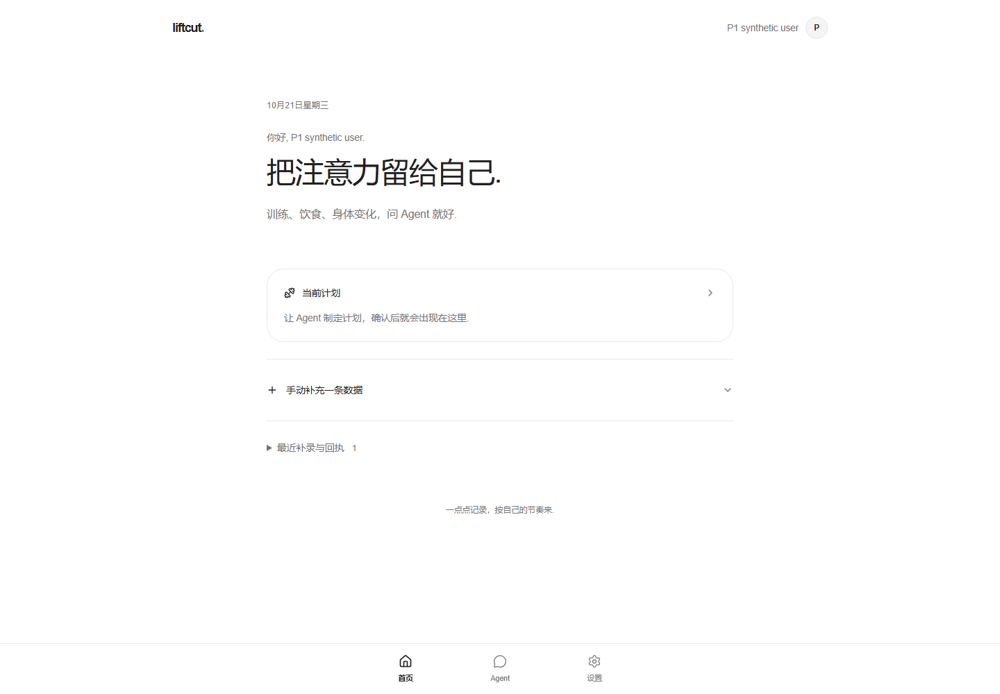
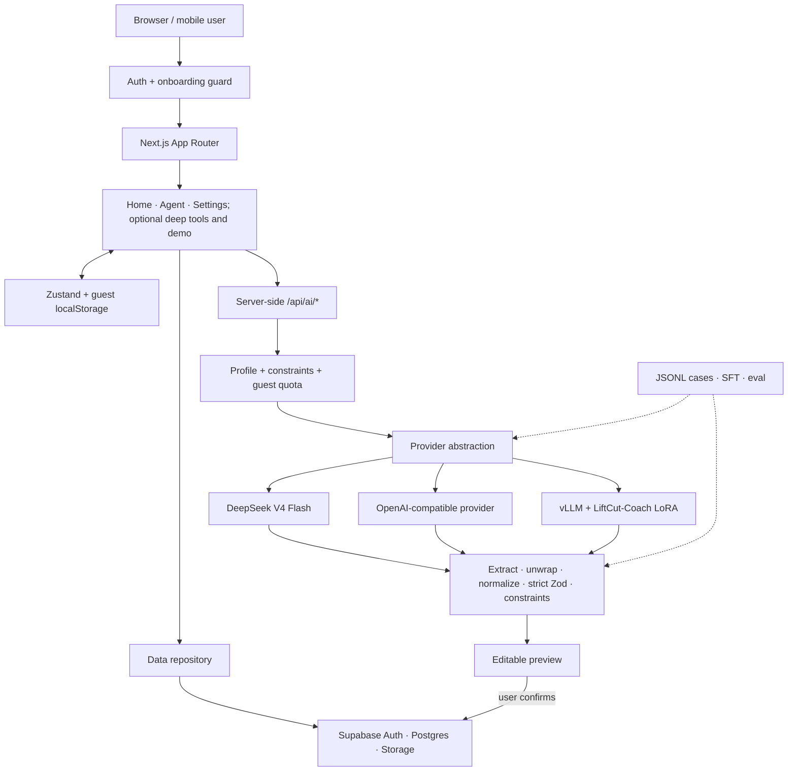
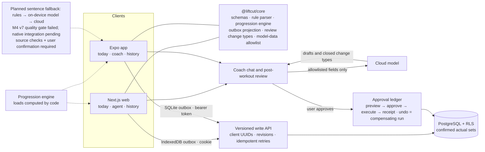

# LiftCut Tracker

<p align="center">
  <a href="https://www.liftcuttracker.com/">
    
  </a>
</p>

<p align="center">
  <strong>训练、饮食、身体变化，问 Agent 就好.</strong><br />
  An open-source fitness application and tool-using agent research project by <a href="https://townzc.github.io/">Zhice Tang</a>.
</p>

<p align="center">
  <strong><a href="https://www.liftcuttracker.com/">🌐 Official website · www.liftcuttracker.com</a></strong>
  ·
  <strong><a href="https://www.liftcuttracker.com/demo">🏋️ No-sign-in beginner demo</a></strong>
  ·
  <a href="docs/AGENT_RESEARCH_PROGRESS.md">🔬 Agent research and evidence</a>
  ·
  <a href="https://townzc.github.io/">👤 Author</a>
</p>

<p align="center">
  <a href="https://github.com/Townzc/liftcut-tracker/actions/workflows/ci.yml"></a>
  <a href="https://www.liftcuttracker.com/"></a>
  <a href="LICENSE"></a>
  <a href="https://hub.xerj.org/contributors/Townzc"></a>
  
  
</p>

LiftCut brings workout completion, exercise performance, food logs, body trends, and AI-generated plans into one bilingual product. Its AI layer treats model output as untrusted structured data: every plan is extracted, normalized, strictly validated, shown in an editable preview, and saved only after user confirmation.

**已被 XERJ 语料库选录 · Selected for the XERJ Corpus Hub.** [查看官方收录记录 / View contributor record](https://hub.xerj.org/contributors/Townzc).

## Current product experience · October 2026

The primary navigation is **Home · Agent · Settings**, in black, white and neutral gray. Home keeps manual entry optional. Agent reads saved body measurements, meals and workout history, and prepares entries from explicit numbers for confirmation. Training details and plan tools are reached through Agent.

Try `最近体重`, `今天吃了什么`, `本周训练`, `记下体重 72.5 公斤`, or `记录午餐 鸡肉饭 600 千卡 蛋白质 35 克`. English examples include `my recent weight` and `log lunch rice`. Unknown values stay `null`; entering a food name does not estimate nutrients. Saved receipts retain the original input and compensating undo history. Training sets can expose their source and revision events.

After separate consent, **open-ended DeepSeek conversation** can answer follow-ups, read current records through narrow tools, and interpret natural body, food and current-workout reports. Try `今早上秤七十二点五公斤，腰围没量，给我记一下` or `那昨天呢？`. Replies show an AI label and expandable data sources. Numeric draft values must be grounded in literal user spans; server signatures bind a draft to the authenticated owner, UUID and exact content. The model has no write tools. Every entry still needs an explicit confirmation.

Deterministic entry phrases remain available without model consent and offline. Workout requests use the existing IndexedDB outbox; independent entries use account-scoped immutable localStorage requests and the PostgreSQL receipt ledger. Offline support requires an already loaded page; there is no offline cold-start or background-delivery guarantee. Account conversations persist across pages and reloads. Six recent turns are sent as conversational context; confirmed measurements and fitness preferences remain separately queryable by date. Guest AI uses a bounded trial and confirmed local records can be imported after login with explicit confirmation.

Training and nutrition proposals automatically read saved goals, dated body measurements, restrictions and recent actual exercise loads. Current requests override preferences for that proposal only; confirmed preferences override older settings. The server binds each proposal to the data it used and rejects approval if relevant records changed or were undone. Plans remain prescriptions; only explicitly confirmed reports become actual records. See [plan memory verification](docs/product/PLAN_MEMORY_VERIFICATION.md) and the [current delivery status](docs/product/AGENT_PRODUCT_STATUS.md).

The [model conversation verification](docs/product/MODEL_CONVERSATION_VERIFICATION.md) separates scripted CI tests from actual DeepSeek calls and hosted release checks.

See the [UI verification report](docs/product/MINIMAL_AGENT_VERIFICATION.md), [saved-history freshness fix and verification](docs/product/AGENT_QUERY_FRESHNESS.md), [product engineering Q&A](docs/product/PRODUCT_ENGINEERING_QA.md), and [recorded 90-second walkthrough](docs/product/evidence/minimal-agent/minimal-agent-demo.webm). Screenshots and video use synthetic data; the video uses local Auth fixtures and real API/PostgreSQL. The research sections below retain their original historical context; the [current product plan](docs/product/2026-10-13-showcase-plan.md) defines the delivery priority.

## Project at a glance

| Product | AI system | Research result | Delivery |
| --- | --- | --- | --- |
| Training, nutrition, body trends, onboarding, guest mode, and PDF export | Typed tools, explicit confirmation, temporal memory and replayable state transitions | Qwen3-4B QLoRA with matched-target ablations and auditable development failures; independent evaluation pending | Web application plus a standalone [Python research lab](research/liftcut-agent/README.md) |

> **Try it first:** the [public beginner demo](https://www.liftcuttracker.com/demo) works without an account or AI key.

## Why LiftCut?

| Start safely | Build sustainable habits | See the trend | Get reliable AI output |
| --- | --- | --- | --- |
| Bilingual movement demo, easier variations, coaching cues, and conservative starting doses. | Editable plans and daily logs instead of a rigid one-size-fits-all program. | Training, nutrition, and body data stay connected rather than scattered across apps. | Model output is extracted, normalized, strictly validated, previewed, and only saved after confirmation. |

### What is implemented

- public bilingual `/demo` with body-area filters, six starter movements, regressions, cues, and safety boundaries;
- account onboarding plus a local-first guest mode that can later migrate data to Supabase;
- editable training plans, text import, workout logging, personal records, and PDF export;
- food logging, nutrition summaries, body measurements, and trend charts;
- server-side AI training and nutrition generation with structured preview/edit/confirm-save flow;
- DeepSeek, generic OpenAI-compatible, and local vLLM provider modes;
- versioned prompts, Zod schemas, generation history, evaluation scripts, and local LoRA research assets.

The demo adapts a small MIT-licensed **text** subset from [`hasaneyldrm/exercises-dataset`](https://github.com/hasaneyldrm/exercises-dataset). LiftCut's hero artwork is original; the reference repository's separately licensed images and videos are not copied. See [third-party notices](THIRD_PARTY_NOTICES.md).

## Historical structured-output research

The repository includes a reproducible LiftCut-Coach research pipeline for dataset validation, train/validation/test splitting, SFT conversion, provider evaluation, and local LoRA serving.

| Model | JSON Parse | Final Schema | Constraint Pass | Avg Latency | P50 | P95 |
| --- | ---: | ---: | ---: | ---: | ---: | ---: |
| DeepSeek v4 Pro | 99.66% | 97.95% | 97.95% | 147.7s | 133.6s | 277.4s |
| MiMo v2.5 Pro | 99.32% | 98.29% | 97.27% | 38.7s | 35.3s | 65.6s |
| **LiftCut-Coach LoRA** | **100.00%** | **100.00%** | **99.66%** | **36.8s** | **33.0s** | **63.3s** |

These historical reported results cover 293 held-out evaluation cases and should be read as a structured-output engineering benchmark, not as evidence of clinical effectiveness. The complete original evaluation artifacts are not checked in and have not been reproduced by the new AgentLab work. See the [technical report](docs/LiftCut-Coach-Technical-Report.md) and [measurement audit](docs/research/2026-09-28-evaluation-audit.md) for definitions, evidence gaps, and follow-up checks.

## System architecture



### Web, mobile app and agent (2026-10)

One shared core runs on both clients; every write goes through the same versioned API, and the model only ever drafts.



See the [mobile plan](docs/product/2026-10-18-mobile-agent-plan.md), [product log](docs/product/PRODUCT_LOG.md) and the [90-second phone demo](docs/product/DEMO_90S.md) (synthetic data; the coach answer in it is a scripted fixture).

[M4 v7 evidence](research/m4-parser/results/run-20261023T001500Z-v7/README.md): one fixed prompt-alignment training and 3,120 new predictions completed. Candidate challenge accuracy is 180/240 versus cached control 195/240; Q8 agreement is 97.40% against HF and 97.88% against F16. Missing units, RPE scope and exercise binding still reject the candidate. Complete artifact restoration, 31-report replay and CPU diagnostics are verified; native integration remains pending. The [v6 comparison](research/m4-parser/results/run-20261022T184300Z-v6/README.md) remains historical evidence.

The [v8 preparation](research/m4-parser/results/contract-v8-20261023/README.md) separates training and inference prompts in a fixed 2×2 comparison. Its [history audit](research/m4-parser/results/contract-v8-20261023/HISTORY.md) confirms the earlier 213/240 peak on identical challenge bytes. Full token/mask checks, two CPU optimizer steps, saved-output replay and artifact restoration passed; final-head CI and source recovery precede a fresh GPU notice. All 6,400 training tuples and numeric gates stay fixed. The private 20 utterances and all derivatives remain excluded. Candidate continuous-dialogue acceptance, useful incremental coverage and physical-device validation still precede native activation; there is no v8 model result yet.

## AI reliability pipeline

Every generated plan follows the same deterministic boundary:

```text
strict prompt + schema example
→ provider JSON mode
→ first-complete-object extraction
→ wrapper-key unwrapping
→ enum and field normalization
→ strict final Zod validation
→ business-constraint checks
→ editable preview
→ user-confirmed save
```

DeepSeek V4 requests explicitly use non-thinking mode for bounded structured generation, a provider-specific timeout, no hidden SDK retry loop, and a maximum output-token limit. API keys remain server-only and error details redact the active key.

## Agent research: evaluation before training

Start with the [research evidence index](docs/research/RESEARCH_INDEX.md),
[saved G2 trajectory viewer](research/liftcut-agent/reports/g2-trajectory-demo-2026-10-03.html),
and [learning checkpoints](docs/research/AGENT_LEARNING_GUIDE.md).
The [completed G2 pilot](docs/research/2026-10-03-g2-complete-results.md) restores
full tasks2/12→10/12 and repair3/4→4/4, but true infeasible cases regress2/4→0/4.
Its original mechanism and candidate gates both fail; memory remains below fixed
S0. No overall adapter has been promoted, and the48 reserved tasks remain unused.
The [next local plan](docs/research/2026-10-03-post-g2-next-plan.md) separates stopping
decisions from memory selection; no additional paid experiment has started.

LiftCut-AgentLab studies tool use and post-training for plan adjustments under changing constraints. The dependency-free Python lab now includes **30 proposal development cases and 14 interactive development scenarios**, eight typed tools, versioned user confirmation, temporal preferences, controlled timeouts, and executable trace replay. It runs without GPU or API access.

```bash
python research/liftcut-agent/run.py validate
python research/liftcut-agent/run.py baseline
python research/liftcut-agent/interact.py run
python research/liftcut-agent/interact.py replay --traces research/liftcut-agent/reports/interactive-fixed-traces-2026-09-28.jsonl
python -m unittest discover -s research/liftcut-agent/tests -v
```

The fixed workflow completes 14/14 interactive seeds; ignoring memory completes 12/14 and disabling retries completes 11/14. These are scripted development checks of the environment, **not LLM, training, or generalization results**. The fixtures use artificial exercise blocks and time costs. See the [experiment record](docs/research/2026-09-28-interactive-environment.md).

The first full hosted reference (`deepseek-flash`, non-thinking) passed **8/14 public development tasks** in 70 calls: five single-call protocol mismatches and one terminal-label failure were retained. All trajectories replay offline. The conservative cost estimate is $0.0433947; this is not a reconciled bill or training gain. See the [baseline, failure analysis and cost audit](docs/research/2026-09-28-development-baseline.md).

The next protocol version supports bounded read-only batches and a separately tested pending-approval instruction. Its hosted four-arm live comparison is still pending; 8/14 remains the hosted reference result. The original **59 development decisions / 2,766 target tokens** CPU pipeline has since been followed by actual Qwen3-4B QLoRA pilots on an RTX 4090. The paired recovery-data pilot trained two adapters with **38 optimizer steps and 12,758 supervised tokens each**. Review discovered category hints in fixture IDs, so its original high scores are retained as contaminated diagnostics. See the [executed training, validity correction and next experiment](docs/research/2026-09-29-recovery-results.md); these are not generalization claims.

The subsequent [corrected controlled study](docs/research/2026-09-29-controlled-recovery-results.md) completed normal development tasks at **0/12 (base), 10/12 (clean SFT), and 11/12 (recovery SFT)**. The recovery gain missed its preregistered gate. [Fixed-state diagnostics](docs/research/2026-09-29-state-diagnostic-results.md) then exposed sensitivity to read history and memory order.

The [completed four-arm state-coverage study](docs/research/2026-09-29-state-coverage-results.md) trained matched-target S0/T/M/TM adapters: normal tasks **10/12, 9/12, 11/12, 9/12**. T improves read-history consent from 0/3 to 3/3 in the S0 comparison, while M misses its memory gate and TM adds three unapproved-write attempts, all blocked by the environment. All **124 episodes and 407 native generations** replay; actual adapters were backed up. These are the original seed42 results. The subsequent [R1 three-seed review](docs/research/2026-10-02-r1-three-seed-results.md) repeats the local S0→T screen3/3 but finds no treatment satisfying all-seed candidate protections. Independent validation remains pending.

| Phase | Deliverable | Write access |
| --- | --- | --- |
| P0 · implemented | Offline development fixtures, strict proposal scoring, evaluation audit | None |
| P1 · development baselines recorded | Tools, replay, memory, recovery; hosted and local-model comparisons with auditable failures | Simulated confirmation boundary |
| P2 · controlled development studies executed | Paired trajectory SFT, corrected identifiers, exact target-token matching, weight reload and replay audits; reserved evaluation pending | Offline research |
| P3 · in progress | Four-arm state-coverage ablation, research report, independent validation and minimal demonstration | Offline research |
| P4–P5 · planned | Preference optimization; one online RL or visual-understanding extension | Product writes require confirmed proposals |

Read the [research quickstart](research/liftcut-agent/README.md), [technical roadmap](docs/AGENT_RESEARCH_ROADMAP.md), and [current progress](docs/AGENT_RESEARCH_PROGRESS.md). The earlier [AI Coach blueprint](docs/AI_COACH_AGENT.md) remains a product integration reference; the research roadmap defines implementation order.

The [model-policy adapter](docs/research/2026-09-28-model-policy.md) adds strict native
function calling, request/token/cost reservation limits, raw response and usage
records, and offline response replay. Its credential-free mock verifies the
protocol; it is not a live-model or training benchmark.
An initial `deepseek-flash` pilot passed one development scenario in 8 requests;
its complete response records replay offline. Broader model comparisons remain
pending; see the adapter report for cost and limitations.

## Pages and routes

| Route | Purpose |
| --- | --- |
| `/` | Minimal home, current plan and optional manual entries |
| `/agent` | Unified saved-data queries, confirmed entries and workout conversation |
| `/coach` | Compatibility route for the Agent workspace |
| `/today` | Detailed training card, opened from Agent |
| `/demo` | Public beginner movement explorer |
| `/plan` | Training plan management and PDF export |
| `/plan/ai` | AI plan generation, structured preview, edit, and save |
| `/workout` | Workout execution and history |
| `/nutrition` | Legacy food detail tool; new nullable entries are read in Agent |
| `/body` | Legacy body detail tool; new nullable entries are read in Agent |
| `/settings` | Profile, goals, preferences, language, and data controls |
| `/onboarding` | First-run profile setup |

## Tech stack

**Product:** Next.js 16 App Router, TypeScript strict, Tailwind CSS, shadcn/ui, Zustand, next-intl, Recharts, jsPDF

**Backend:** Next.js server routes, Supabase Auth, Postgres, Storage, Row Level Security, Zod

**AI and research:** OpenAI-compatible SDK, DeepSeek V4, vLLM, Qwen2.5-14B-Instruct, LoRA, LLaMA-Factory, JSONL evaluation tooling

## Quick start

```bash
git clone https://github.com/Townzc/liftcut-tracker.git
cd liftcut-tracker
npm install
copy .env.example .env.local
npm run dev
```

Open `http://localhost:3000`. The public demo and most guest tracking flows can be explored without an AI key.

### Minimum environment

```env
NEXT_PUBLIC_SUPABASE_URL=your_supabase_project_url
NEXT_PUBLIC_SUPABASE_ANON_KEY=your_publishable_or_anon_key

AI_PROVIDER=deepseek
DEEPSEEK_API_KEY=your_server_only_key
DEEPSEEK_BASE_URL=https://api.deepseek.com/v1
DEEPSEEK_MODEL=deepseek-v4-flash
DEEPSEEK_REQUEST_TIMEOUT_MS=45000
```

Provider modes:

| `AI_PROVIDER` | Use case | Main variables |
| --- | --- | --- |
| `deepseek` | hosted production model | `DEEPSEEK_API_KEY`, `DEEPSEEK_MODEL`, `DEEPSEEK_REQUEST_TIMEOUT_MS` |
| `local` | research/demo with vLLM | `LOCAL_AI_BASE_URL`, `LOCAL_AI_MODEL`, `LOCAL_AI_REQUEST_TIMEOUT_MS` |
| `openai_compatible` | another compatible service | `AI_BASE_URL`, `AI_API_KEY`, `AI_MODEL`, `AI_REQUEST_TIMEOUT_MS` |

Never put a real AI key in a `NEXT_PUBLIC_` variable, browser code, logs, fixtures, commits, or screenshots.

## Research workflow

```bash
# Validate examples or generated data against the production schemas
npm run research:validate -- research/liftcut-coach/data/examples/training_plan_sample.jsonl

# Build SFT data and deterministic splits
npm run research:build-sft -- output.jsonl input.jsonl
npm run research:split -- input.jsonl output_dir 0.8 0.1 0.1

# Generate cases and evaluate the selected provider
npm run research:generate -- cases.jsonl output.jsonl
npm run research:split-convert -- test.jsonl eval_cases.jsonl
npm run research:eval -- eval_cases.jsonl output_prefix
```

Full instructions: [`research/liftcut-coach/README.md`](research/liftcut-coach/README.md).

## Quality checks

```bash
npm test
npm run lint
npm run build
```

The CI workflow runs against `main` and `aliyun`. AI plans are validated before persistence; guest AI usage is quota-limited; Supabase tables use ownership-based RLS policies.

Health content is general educational information. LiftCut does not diagnose injuries or medical conditions and does not replace a doctor, registered dietitian, physical therapist, or qualified coach.

## Documentation

- [AI Coach Agent blueprint](docs/AI_COACH_AGENT.md)
- [LiftCut-Coach technical report](docs/LiftCut-Coach-Technical-Report.md)
- [Project structure](docs/Project-Structure.md)
- [Interview Q&A](docs/Interview-QA.md)
- [Server runbook example](docs/server-runbook.example.md)
- [Contributing](CONTRIBUTING.md)
- [Security policy](SECURITY.md)
- [Third-party notices](THIRD_PARTY_NOTICES.md)

## Maintainer

LiftCut is designed, implemented, and maintained by [Zhice Tang](https://townzc.github.io/), an undergraduate AI researcher at Chongqing University and a Fall 2026 exchange student at UC Berkeley. Research and engineering details are available in the [technical report](docs/LiftCut-Coach-Technical-Report.md); project questions and focused contributions are welcome through GitHub Issues.

## Contributing and license

Issues and focused pull requests are welcome. Good first contributions include demo accessibility, exercise-data review, AI safety fixtures, schema regression cases, translations, and smaller local-model experiments.

LiftCut Tracker is released under the [MIT License](LICENSE).
