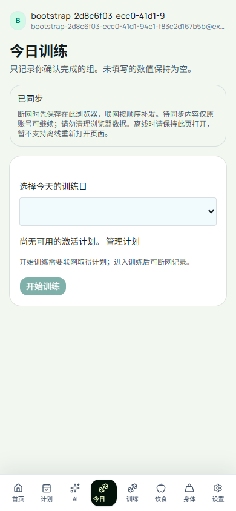

# 新账号初始化：演示数据不能成为真实历史

## 为什么紧接 W3a 修正

W3a 正式网站验收时，为测试跨账号隔离创建了两个全新的合成账号。独立查库发现旧明细总数从 100 变成 105；逐条核对确认原有 100 条没变，额外 5 条属于第二个合成账号。源码定位到 `ensureUserBootstrap`：只要账号没有训练计划，就会保存 `createDemoSnapshot` 的计划、训练、饮食和身体记录。它是既有行为，不是本轮离线队列重复提交。

这与产品“实际记录必须来自用户”冲突，所以先修这个确定问题，再推进 W3b 动作替换。没有推测或批量删除旧账号历史；旧记录来源无法自动可靠分类。

## 改动与边界

- 真实登录只确保 profile 和默认设置存在，不再自动创建计划或 observed health logs。
- 无计划账号使用原本已有的空计划读取视图，界面提示建立计划；不会用演示计划伪装成用户已选择的计划。
- `/demo`/访客演示使用的样例生成器保持原样；用户主动记录、导入和现有迁移流程不在本次变更范围。
- 无数据库迁移；不改已有用户数据、研究源、模型或批准账本。

## 验证与发布

在实际浏览器登录入口增加回归：无计划的第二个合成账号完成初始化与今日页读取，监控所有 PostgREST 写请求，除 profile/settings 外不得发出任何计划、训练、饮食或身体写入；无活跃会话、无训练日、无回执，开始按钮禁用。身份服务仍为本地 HTTP 契约替身，因此另需部署后的真实新账号验证。

本地生产构建的首次回归漏配 `NEXT_PUBLIC_SUPABASE_URL/ANON_KEY`，登录框未启用。观察到首例超时后终止后续无效运行，保留 [失败](evidence/w3a/bootstrap-browser-env-failure.log)；补齐编译时 loopback 环境后重新构建，不把它当作应用缺陷。测试和 lint 的最终输出见同目录；后续真实正式验证见下一节，不把本地结果替代生产证据。

最终本地 **70 单测、17 个浏览器场景全部通过**（新增登录初始化回归，其余 16 项完整重跑）；生产构建成功，lint 0 error / 2 条原有警告。见 [单测](evidence/w3a/bootstrap-unit.log)、[浏览器](evidence/w3a/bootstrap-browser.log)、[构建](evidence/w3a/bootstrap-build.log)、[lint](evidence/w3a/bootstrap-lint.log)。数据库事务实现未改，原 17 项 PostgreSQL 验证不冒充本次本地重新执行；最终 CI 的全部八项结果另行记录。

## 正式发布与真实新账号验收（UTC 2026-10-14）

- #72 最终提交 `c265fe94a6adbd44b03dc05211c4100588e4a5f1` 的全部 **8 项检查 SUCCESS**，05:25:56 合入 main `4b469b3c7da2ed035f3373c4d470c4839f7aab84`；受检与合并树同为 `0fddb69656e6fce2e1b97e71e3128a209f183806`。见 [最终检查](evidence/bootstrap-release/pr72-final-checks.json)、[合并记录](evidence/bootstrap-release/pr72-merge.json)。未改已通过的实验源。
- Git 自动部署 `dpl_C9PETs4zyju7osYPXSSYMusUnK5K`，05:27:03.962 READY，正式别名 `www.liftcuttracker.com` 指向该 main 提交；没有重复手动部署。[部署元数据](evidence/bootstrap-release/deployment.json)
- **部署就绪后**才创建一个全新的合成 Auth 身份，不预置计划、profile、settings 或训练历史；[创建后独立查库](evidence/bootstrap-release/seed-result.json) 证实这些表均为空。使用真实 GoTrue 登录，明确填写合成的基础资料，经过 UI 保存进入应用，而非跳过初始化。
- 05:28:26.617 真实浏览器流程完成：今日卡无训练日、无会话、无回执，开始按钮禁用；刷新、退出登录、重新登录仍为空，退出后的 API 为 401。捕获写入仅 **profile 1 次、settings 2 次**（默认初始化和用户明确填写），无计划/健康历史写请求、无 JS 异常、无模型调用。[执行脚本](evidence/bootstrap-release/hosted-test.cjs.txt)、[原始结果](evidence/bootstrap-release/production-result.json)、[输出](evidence/bootstrap-release/browser.log)
- 05:29:02.551917 **另行查库**：profile/settings 各 1；训练计划、旧训练记录、饮食、身体记录、今日会话、组、回执和事件全为 0。UI 空白不是接口失败的替代证据。[数据库结果](evidence/bootstrap-release/postflight-result.json)
- 05:29:15.449600 按精确 UUID、临时标记和合成邮箱核对后，撤销刷新令牌/会话，再删除该临时账号及级联数据；所有夹具计数为 0。原有 6 账号、100 条旧动作记录保留，与迁移前备份的双向差异 0。本地临时口令与带口令的 seed SQL 已删除。[清理结果](evidence/bootstrap-release/cleanup-result.json)、[本地敏感文件清理](evidence/bootstrap-release/local-private-cleanup.json)

手机宽度截图已实际打开检查：空计划说明和禁用按钮可见，无水平溢出。此验证是桌面 Chromium 的手机视口，不冒充 iOS、Android 或微信真机测试；既有用户中无法辨认来源的历史仍不自动清除。所有新发布原始文件均由 [SHA-256 清单](evidence/bootstrap-release/SHA256.json) 绑定，不公开口令或真实健康记录。

下一步：按 [W3b 实施设计](W3B_IMPLEMENTATION_DESIGN.md) 做小型动作目录、会话变更回执与离线冲突验证。设计仍未实现，不需要 GPU 服务器。
