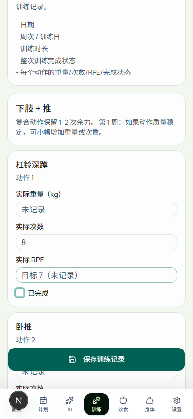
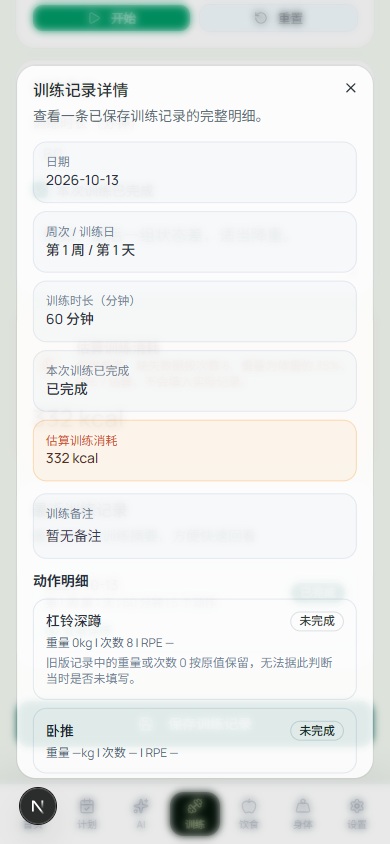

# W1a：未知实际值保持为空

依据：[第 1 周任务](WEEK1_CODEX_BRIEF.md)。这是旧 `/workout` 记录链路的修复；`/today` 属于 W1b。本次不运行模型、不改研究结果、不执行生产迁移。

## 原因、处理与结果

| 步骤 | 为什么这样做 | 实际结果 |
| --- | --- | --- |
| 核对全部实际值读写入口 | 只清空输入框，数据库或导入仍可能补成 0 | 类型、Zod、repository、store、访客快照和 JSON 导入共用空值规范化；空字符串、缺失值与 SQL NULL 保持 `null` |
| 修正默认值与编辑 | 目标 RPE 不是实际测量；原 NumericInput 清空后失焦会恢复旧值 | 三个实际值初始为空；次数/RPE 目标只在 placeholder；可选输入清空即发布 `null`，保存后刷新仍为空 |
| 向前迁移历史数据 | 只能清理可识别的旧哨兵值，不能猜测用户意图 | 三列可空，只清理历史 RPE 0；重量/次数 0、与目标相同的非零 RPE 不变；迁移重复执行通过 |
| 修正统计与显示 | 统计不能把未知测量当作零或个人纪录 | 历史显示 `—`；PR 跳过缺重量或次数的动作；热量仅在计算中使用缺失假设（8 次、体重 35%、RPE 7），注明估算且不写回实际值 |
| 验证真实浏览器链路 | 单元测试不能证明编辑、失焦、存储和刷新行为 | Chromium 390×844：仅填次数、RPE 填写后清空、保存、刷新、明确填写重量 0、再刷新、详情均通过 |
| 修正测试暴露的访客详情缺陷 | 访客已能保存，却因 `user === null` 被拒绝查看自己的历史 | 访客仅匹配 `guest-local`，登录用户继续匹配自己的 user ID；数据库跨用户访问仍被 RLS 拒绝 |
| 隔离历史研究 CI | P1-M 冻结清单包含旧 `schema.sql`，不能拿新产品 schema 冒充原冻结系统 | 全部原 P1-M 校验在精确 `1c7e25bdcde8eb0acdd4f171e8b8e23475ec9d06` 副本和独立测试库运行；当前产品仍运行 P1 事务测试及新增 W1a 校验，未改冻结清单 |

## 实际运行

基线为 main `3ff9beb2704728f5a6f57327f741155aeec9b5e4`。以下均为本地实跑；远端 CI 以 PR 当前提交的 Checks 为准。公开文本输出只规范行尾空白；原始日志保留在本机忽略目录 `node_modules/.cache/w1a/`。

| 命令 / 环境 | 结果与证据 |
| --- | --- |
| `npm run lint`、`npm test`、`npm run build`（改动前） | 基线通过：8 个 MJS + 39 个 TS 测试；lint 有研究目录原有两条 `_rand` 警告 |
| `npm test` | [54 项通过](evidence/w1a/unit-tests.txt)：8 MJS + 46 TS；覆盖空值、非法值、读回、JSON、访客 store、PR 与热量假设 |
| `npm run lint` | [0 errors，2 个原有警告](evidence/w1a/lint.txt) |
| `npm run build` | [Next.js 16.2.9 生产构建通过](evidence/w1a/build.txt)，包含 TypeScript 检查 |
| `W1A_TEST_DATABASE_URL=… node --import tsx --test tests/product-db/workout-values.test.ts` | [本机 PostgreSQL 16 通过](evidence/w1a/database.txt)：旧 NOT NULL 确实拒绝空值；迁移两次；SQL NULL 经实际应用 mapper 读回；已知历史值与 RLS 不变；本人写入成功、他人读写被拒绝 |
| `npx playwright test --config playwright.w1a.config.ts` | [1 个完整浏览器场景通过](evidence/w1a/browser.txt)，实际 guest store/localStorage，未伪装成托管认证/数据库端到端测试 |

手机宽度截图（合成数据，非真机）：

| 实际字段为空，目标仅提示 | 保存、刷新后的历史详情 |
| --- | --- |
|  |  |

## 调试记录与边界

- 第一次日志重定向目标目录不存在，命令未运行；建立忽略目录后重新执行，只有真实输出计入上述结果。
- 数据库夹具最初因 schema 的 UTF-8 BOM、随后因缺必填父记录字段失败；修正夹具后在新的空测试库执行，再补本人角色实际提交验证。没有清理生产数据。
- 浏览器最初因“查看详情”按钮包含额外可访问文字而定位失败；修正选择器后暴露访客详情拒绝问题，修复应用后通过。最后只调整截图取景为手机视口并复跑。
- 首次远端 CI 的当前产品与 W1a PostgreSQL/浏览器校验通过，随后原冻结 P1-M 安装器拒绝了隔离库名 `liftcut_p1m_ci`（不满足它的 `liftcut_p1_` 安全前缀）。只将 CI 夹具库名改为 `liftcut_p1_model_ci`，不放宽冻结安装器；[原失败日志](https://github.com/Townzc/liftcut-tracker/actions/runs/38487312917/job/115603968177) 保留，新提交重新接受全部检查。
- 第二次 CI 在原协议的失联故障测试中暴露子进程加载失败。本机用同一冻结版本复现：`node_modules` 内的副本无法解析 `@/lib/agent/contracts`。改将副本放到现有 TypeScript 排除的 `research/liftcut-agent/outputs/p1m-frozen-w1a`，不改冻结文件；真实新测试库安装后 8 项协议测试通过，3 项 native 测试因本次本地未设 tokenizer 而明确跳过，完整 native 校验仍由 CI 执行。[第二次失败](https://github.com/Townzc/liftcut-tracker/actions/runs/38487590998/job/115604870923) 保留。
- PostgreSQL 使用合成 `auth.uid()` 身份契约测试真实 RLS；没有调用托管 Supabase Auth/GoTrue。浏览器验证访客持久化，数据库验证实际 SQL 与应用读取；二者不能合称托管登录全链路验收。
- 未执行生产迁移、生产部署或真机微信测试；未实现 W1b 的会话、逐组记录、版本冲突、双击去重或撤销。旧记录 repository 的多请求保存事务问题留在后续产品写入链路处理，不宣称此次已解决。
- 旧重量/次数 0 及目标误填的非零 RPE 没有可靠来源信息，不能自动区分。保留数值并提示历史零值边界，不推断或回填。

## 上线顺序与下一步

先审阅 W1a PR；经维护者允许后，在目标数据库备份并执行 `20261013234503_unknown_workout_actuals.sql`，再部署支持空值的应用。迁移前的新应用可能保存失败；历史已经为空的记录也不适合退回将 NULL 映射为 0 的旧客户端。回滚应用前需评估这一兼容边界，不用填 0 的反向迁移抹掉未知状态。

W1a 合并后开始 W1b：功能开关后的今日训练卡、实际逐组输入、版本检查和补偿式撤销。P1-M 保留为可选准备，不占用产品交付窗口。
