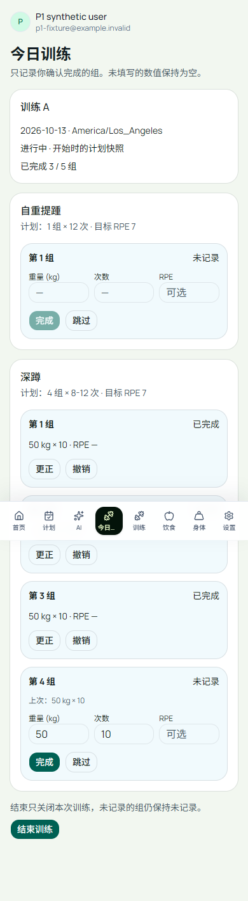
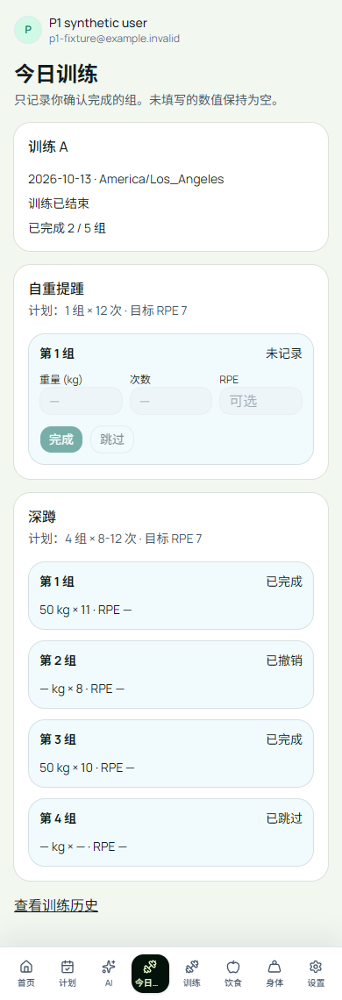

# W1b：今日训练卡的实现与验证

2026-10-13（维护者洛杉矶日期；迁移文件名由 CLI 按 UTC 生成）。本次是产品工程工作，没有 GPU、模型调用或生产数据库操作。

## 交付范围与分支

按 [第 1 周任务](WEEK1_CODEX_BRIEF.md) 实现功能开关后的 `/today`。W1a 的已受检提交为 `5ed487de7f05c5c87523abe75ff0419bcf0324c2`，PR #65 尚未合并。为了继续已授权的开发，同时遵守任务“不合并到 main”的要求，W1b 使用基于该提交的叠加分支 `feat/today-session`，PR 基线指向 W1a。实际合并顺序仍必须是 W1a → W1b；不能跳过 W1a 的迁移，也不能把本地验证当成生产上线。

## 每步的原因、实施与结果

| 步骤 | 原因和选择 | 实际结果 |
| --- | --- | --- |
| 基线 | 先检查旧页面、测试和构建，避免把原有问题算作新功能回归 | lint/build 成功；54 个原测试中 1 个日期夹具失败，见下面失败记录 |
| 数据迁移 | 旧表按动作汇总，无法表达每组状态、版本和撤销 | 新建 `workout_sessions`、`set_logs` 及追加事件表；原表不双写；CLI 创建迁移名，并同步新装 schema |
| 写入边界 | UUID 本身不能阻止旧请求覆盖更正 | 独立 `liftcut_workout` 受限角色；身份来自服务端 `auth.getUser()`；每用户事务锁、当前版本和规范化内容哈希检查；重复请求不重复新增事件 |
| 计划快照 | 以后修改计划不能改变已开始训练的目标 | 服务端单条查询读取激活计划当天处方，保存为快照；已有计划只有周/天序号，没有真实排期，界面让用户选择今日训练日，不猜测完成情况 |
| 实际值与来源 | 计划目标不能冒充实际，历史 RPE 也不能自动成为本次值 | 上次同名动作的重量/次数只在点按后记入；两字段分别记来源；RPE 永不预填；无上次值时必须填次数，重量可空 |
| 更正和撤销 | 既要修正记录，也要保留发生过的操作 | 更正递增 revision；撤销保留原数值和前后事件，标为 voided；旧版本重发拒绝；未记录的组不因结束训练而生成 |
| 历史适配 | 双写会产生重复计数和两份状态 | 读取适配器把每条 done 组映射到旧页面/PR/图表；排除 skipped/voided，热量估算按实际一组计算，避免乘回计划组数 |
| 时区 | UTC 归日会把晚间训练移到次日 | 浏览器发送 IANA 时区，服务端按实际开始时间保存 local_date；结束不改开始日期 |
| 故障与隔离 | 成功响应可能丢失；跨用户访问不能只靠页面约定 | 真 PostgreSQL 并发、版本、RLS；浏览器实际提交后丢弃响应，再重试并刷新查询同一条记录，全部通过 |
| 功能开关 | 新流程要能关闭，已存历史仍须读取 | `FEATURE_TODAY_SESSION` 仅服务端读取，浏览器只获布尔值；关闭时隐藏入口、阻止新会话/写入；已配置数据库的历史仍读取 |

数据库迁移在这里是**可追踪的表结构变更脚本**，不是搬迁服务器。W1a 允许旧三列存 SQL NULL；W1b 增加新表、约束、索引、权限与 RLS。提交 SQL 文件不等于已经在生产数据库执行。

## 实际运行的验证

所有公开样例均为合成用户、合成训练数据。PostgreSQL 16 在本机 WSL；浏览器使用 Chromium 390×844，不是真机。

| 命令/验证 | 结果与证据 |
| --- | --- |
| `npm test` | [57 项通过](evidence/w1b/unit.txt)：8 MJS + 49 TS；含日期、实际值/来源校验、void 排除及逐组热量 |
| `npm run lint` | [0 errors、2 条原有 research 警告](evidence/w1b/lint.txt)，未修改研究代码 |
| `npm run build` | [生产构建及 TypeScript 通过](evidence/w1b/build.txt)，新 `/today` 和两条 API 路由已生成 |
| `W1B_TEST_DATABASE_URL=… node --conditions=react-server --import tsx --test tests/product-db/today.test.ts` | [7 项通过](evidence/w1b/database.txt)：从实际 W1a Git schema 升级；并发 start/set、NULL、修正/撤销、原子版本冲突、RLS 跨用户和改 owner 拒绝、两地跨午夜、计划快照、无旧表双写 |
| `npx playwright test --config playwright.w1b.config.ts` | [4 项通过](evidence/w1b/browser.txt)：登录契约→实际 Next API→真实 PostgreSQL→响应/页面；三组刷新、响应丢失后重试、更正、撤销、历史横线、flag off、未认证/跨域拒绝，及旧访客页保存刷新回归 |
| Supabase CLI `db advisors --db-url <本地测试库> --type security --level warn` | [运行成功，1 个基线 warning](evidence/w1b/advisors.txt)：原 schema 的 pgcrypto 在 public。新三表没有额外 security warning；没有移动旧扩展或改研究依赖 |

浏览器认证使用已有 loopback Supabase HTTP **契约替身**，并非托管 GoTrue。它发放测试 cookie，实际应用的 `auth.getUser()` 通过 HTTP 校验该测试身份；新业务 API、事务、数据库和页面是真实实现。不能据此声称托管认证或生产环境端到端验收完成。公开输出只规范化行尾空白、控制字符和绝对本机路径（替换为 `<repo>`）；测试计数、错误与结果未改，原始日志保留在本机忽略目录。

截图已实际打开检查，布局、状态和空 RPE 文案与数据库结果一致：

| 三组记录刷新后 | 撤销第二组并结束（未记录仍未记录） |
| --- | --- |
|  |  |

关闭开关：[手机截图](evidence/w1b/flag-off-mobile.png)。固定底部导航出现在长截图中间是浏览器 full-page 截图的固定元素行为；真实页面可滚动。

## 失败、修正和审查记录

1. [基线测试失败](evidence/w1b/baseline-test.txt)：`getAverageWeightByDays` 的夹具用 UTC 日期，而函数按本地日期筛选。洛杉矶下午 UTC 已次日，夹具落入“未来”；只把夹具改为既有 `todayString()`。产品统计算法未改；补了洛杉矶/上海午夜和 DST 日期测试。
2. 自审发现“更正一个已保存的 NULL”可能再次套用上次重量。改成有已保存记录时严格采用其值（包括 NULL），只有未记录组才提供历史预填。更正字段来源分别保留或标为用户输入。
3. [第一次浏览器测试](evidence/w1b/browser-first.txt) 已实际保存到数据库，但 `role=alert` 同时匹配 Next 路由播报器和业务提示，导致断言失败。按业务提示文本收窄定位，保留该次日志；新测试库运行最终四项全部通过。
4. 迁移只授予浏览器 authenticated 角色 SELECT；写入必须过服务端事务，不能绕过 revision 或事件。事件表不授予 UPDATE/DELETE。原批准账本与研究冻结源码没有修改。
5. `schema.sql` 中新装定义与迁移保持相同；实际部署只执行未执行过的迁移一次，不应反复运行这个非幂等建表迁移。

## 部署顺序、限制与下一步

先审阅并合并 W1a，再审阅 W1b。经维护者允许后，备份目标数据库并依次应用两条迁移，另行配置 `liftcut_workout` 的 LOGIN 密码与仅服务端的 `WORKOUT_DATABASE_URL`，部署时先保持 `FEATURE_TODAY_SESSION=false`，完成目标环境验证后再开启。迁移不含密码；运行角色不能使用 postgres、service_role 或 BYPASSRLS。关闭开关不删除记录。不要用删除表或填零作为回滚策略。

限制：

- 未执行生产迁移/部署、未合并 W1a/W1b；GitHub 精确提交检查以 PR 实际状态为准。
- 未做真机微信、托管认证、断网重开恢复、AI 解析、动作替换。当前未发送的编辑和内存中的待重试请求不跨页面重载保存；已确认保存的组由服务器恢复。离线发件箱留到第 3 周。
- 当前界面单位为 kg；结束后不再更正，voided 行保留且不可复活。后续撤销更正/结束后修订需要单独定义协议，不能绕过当前版本规则。
- 历史导出包含读取适配后的已完成组，不是事件账本备份。新会话拒绝写入旧 repository；不宣称旧页面本身的多请求写入具有新事务保证。
- 为使服务端开关在同一构建中按运行时配置生效，根布局等待请求后传布尔值；页面变为按请求渲染。未声称性能提升；当前历史查询适合首批少量使用者，后续大量数据需分页/批量读取。
- 本地 browser runner 用 `next start` 执行生产构建，Next 对 standalone 打包给出警告；验证不是 Docker standalone 镜像部署测试。生产继续遵循现有 Docker 发布流程。

下一步：审阅 W1a/W1b，并在受控环境跑托管登录与迁移验收；之后按第 2 周任务实现一句话记录、更正和解析评测集。当前无 GPU 需求；P1-M 仍为可选项，不因产品工作自动开机。

参考：[Supabase RLS 官方指南](https://supabase.com/docs/guides/database/postgres/row-level-security)（权限授予和行隔离必须同时生效）；Next 16.2.9 的 Route Handler、environment variables、`connection()` 指南已从安装包文档读取。
