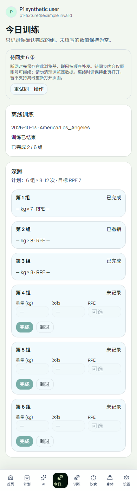
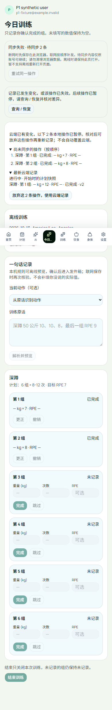

# W3a：离线发件箱验证记录

日期：2026-10-14 UTC（洛杉矶 10 月 13 日晚）。承接已上线的 W2b，任务范围见 [第 3 周任务](WEEK3_CODEX_BRIEF.md)。本条记录区分本地真实 PostgreSQL、本地认证替身和后续正式域名验收；不提前宣布线上通过。

## 1. 为什么先做发件箱

W2b 的事务、UUID 幂等与补偿解决了服务端一致性，但浏览器内存中的未知请求在关页后会丢失。健身房断网时，用户还需要继续记录下一组。因此本次先把待提交操作可靠落盘，再显示待同步；服务端确认之前不会显示成已同步。没有新增数据库结构或迁移，不修改训练研究、原批准账本，也没有模型调用或 GPU 实验。

## 2. 设计选择及其结果

| 步骤与原因 | 实现与实际核验 |
| --- | --- |
| 先落盘，避免 UI 假成功 | 每个账号一条 IndexedDB 状态，队列/快照/租约同事务提交；等事务 `complete` 才更新 UI。存储拒绝测试中输入保留、队列不增长、没有 POST。 |
| 请求结果未知不能换 UUID | 保存原始操作的 UUID、版本和序列化字节；只有收到成功回应才原子移除队首。故意丢掉服务端已提交的响应后关页，两标签重试仍只有一个记录/事件。 |
| 多标签不能争抢补发 | IndexedDB 事务原子领取队首，40 秒租约；请求 15 秒超时，失败退避 10/20/40/60 秒。无 BroadcastChannel/Web Locks 时仍可按 5 秒本地检查恢复；模拟失效租约通过。 |
| 连续离线操作要保持依赖 | 本地按队列投影逐组/更正/撤销/整句/补偿/结束；同一批六步离线请求与数据库逐步实际结果的上下文摘要完全一致。目标值不补实际，空值与 lb 原来源保留。 |
| 整句不能预览后悄悄换组 | 浏览器本机规则解析和 SHA 摘要；入队前检查最新本地上下文与状态版本，服务端仍重新解析/核验。预览后另存一组的故障场景明确拒绝过期草稿。 |
| 账号变化不能把旧操作写给新人 | 账号 ID 分区并重建页面；请求携带原账号标识，服务端在真实认证后比对。此标识不是认证。第二账号既看不到旧队列，也不能提交绑定原账号的请求。 |
| 冲突不能自动覆盖云端 | 409 停止整条依赖队列；显示本地操作与新云端值，用户明确放弃后才移除该队列并保留最近五次本地放弃记录。未知网络结果不提供此删除入口。 |
| 网络提示不能当网络事实 | 自动恢复使用 online/focus 和有限轮询；手动重试不被 `navigator.onLine=false` 阻止。成功与否始终以实际 HTTP 和数据库为准。 |

依据：[MDN IndexedDB 事务与生命周期](https://developer.mozilla.org/en-US/docs/Web/API/IndexedDB_API/Using_IndexedDB)、[online 状态局限](https://developer.mozilla.org/en-US/docs/Web/API/Navigator/onLine)、[可选 Web Locks](https://developer.mozilla.org/en-US/docs/Web/API/Web_Locks_API)。这里使用浏览器存储事务实现领取，不依赖 Web Locks 可用性。

## 3. 实际执行的检查

全部公开数据均为合成夹具。日志、截图与字节哈希在 [evidence/w3a](evidence/w3a/SHA256.json)。

- **70 项单元测试通过**：8 个 MJS + 62 个 TS，含 4 个新发件箱测试。见 [原始输出](evidence/w3a/unit-final.log)。
- **17 项真实本地 PostgreSQL 测试通过**：W1 的 7 项、W2 的 9 项、新增完整离线链回放 1 项，使用非超级用户、无 BYPASSRLS 的运行角色。见 [W1](evidence/w3a/db-today.log)、[W2](evidence/w3a/db-commands.log)、[新回放](evidence/w3a/db-projection.log)。
- 新回放在任何组写入前生成六个相互依赖操作；每步都重复发送同一请求并比较投影摘要。最终 **3 个组、3 个命令、9 个事件**，RPE 为 **NULL/NULL/9**，撤销的 lb 记录保留来源。它是实际数据库执行，不是只 mock Store。
- **16 项 Chromium 手机宽度浏览器测试通过**，其中 10 项新发件箱场景、6 项现有回归；浏览器 → 本机 Next → 本地 PostgreSQL，但身份服务是 HTTP 契约替身，不能当作托管 GoTrue 验收。见 [最终输出](evidence/w3a/browser-final.log)。
- 生产构建通过；lint **0 error，2 条既有研究脚本警告**。见 [build](evidence/w3a/build-final.log)、[lint](evidence/w3a/lint-final.log)。没有新增依赖。

十个新浏览器场景：三组离线加更正/撤销/结束的六次顺序补发；离线整句与补偿；已提交响应丢失/关页/双标签重试；另一设备新版本与两操作队尾暂停；存储配额拒绝；账号切换与绑定校验；401 保留原请求；IndexedDB 不可用；过期整句预览；失效租约且无跨标签 API 的恢复。最后一项是主动注入过期租约，不是操作系统崩溃或真机断电实验。

## 4. 真实失败、修正及学习

1. 首次数据库准备命令把 TS 模块按错误方式调用，未进入数据库；纠正执行方式。随后过宽的 `*.test.ts` 命令触发独立 W1a 环境/新库保护，改成新数据库和明确的三个测试文件。保留 [准备失败](evidence/w3a/db-setup.log)、[过宽命令失败](evidence/w3a/db-all.log)，不将环境失败包装成产品缺陷。
2. 首次新浏览器测试 4 过/2 失败：第一个标签已收到 ACK 后第二个重试按钮会消失，不能再代表并发测试；改成控制回应释放后真正同时领取。切换账号改用应用退出，不能直接打开会被重定向的登录页。[首次输出](evidence/w3a/browser-outbox-first.log)。
3. 第二次全浏览器测试 11 过/3 失败：退出按钮常驻，不能证明退出完成；改查 API 401。新增状态栏令旧宽泛 status 定位有歧义，改指向澄清内容。旧测试把乐观 UI 当服务器确认，在后来更正提交前旧请求返回幂等 200 属正确行为，改为等“已同步”后验证过期 409。[第二次输出](evidence/w3a/browser-all-second.log)。
4. 自审发现整句预览后本地另一写入可导致槽位变化；加本地摘要检查、事务内 revision 再核验、服务端重解析，新增故障用例。第三次 15 项通过；加入租约恢复场景后最终 16 项全部通过。
5. 学习重点：落盘、服务端提交、收到回执是三个时间点；“界面已经变化”不能代替后两项。跨标签锁只能减少重复，服务端幂等才是最终保证。

## 5. 实际渲染检查

已打开实际 Chromium 截图核查手机宽度、待同步状态、空值显示与冲突取舍；横向无溢出。

## 6. 边界、发布与下一步

- 最低支持范围是**已加载并打开的今日训练页**；新训练先取得服务端快照。没有 Service Worker，不承诺断网冷启动/断网刷新页面加载。页面关闭后不后台发送，重新进入才恢复。
- IndexedDB 属同源本机存储；不承诺加密、永不被系统清理、隐私模式关闭后持久化或跨设备迁移。存储不可用会明确阻止保存；本地放弃记录保留最近五次，待同步队列上限 100。
- iOS/Android/微信真机未测试；桌面 Chromium 的手机宽度和故障注入不等价。稳定性能 p95、长期断网与系统杀进程仍无证据。
- 本 PR 最终精确提交通过全部 8 项检查再合并；生产域名将按合并 SHA 检查 READY，然后用新的合成账号验证真实 Auth/离线/补发/冲突/隔离并清理。此处尚未声称该线上流程通过。
- 回滚为回退应用部署；无 DDL 回滚。已落盘的未确认操作不能自动删掉，旧版本不能消费新发件箱时应保留直到恢复支持版本。
- **W3b 本次动作替换仍未实现**；先交付 W3a，随后固定动作资料、当前会话版本与补偿/离线冲突规则，再单独实现。无需开 GPU 服务器。
