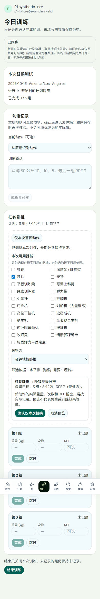
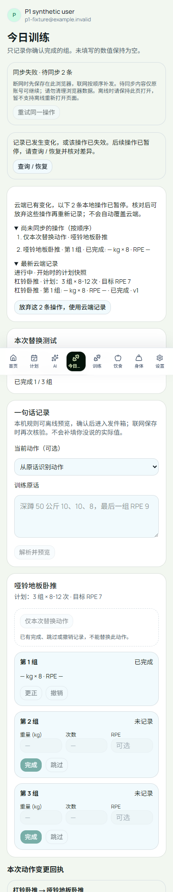
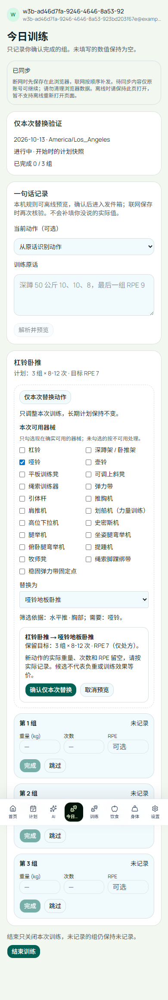
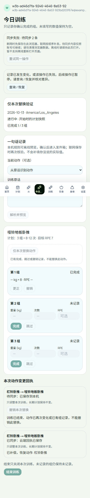
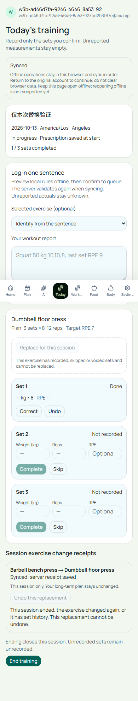

# W3b：本次动作替换实施与验证记录

状态：本次替换、补偿和离线同步已在正式域名完成真实 Auth / API / 数据库验证，合成数据已清理。日志中额外发现的历史读取驱动警告及后续修复单独记录在下方；不需要 GPU。

## 选择及原因

- 依照 [事前设计](W3B_IMPLEMENTATION_DESIGN.md)，给替换和补偿后的动作分配新 UUID。直接改旧 ID 的名字会把另一设备未发送的旧组误记到新动作。
- 只允许零历史的动作；完成、跳过、撤销行都阻止替换与补偿。所有写入沿用本人事务和用户串行锁。
- 采用 60 条本项目独立整理的中英文名称、明确别名、粗粒度动作模式/部位/完整器械集合。没有导入上游数据集、媒体或训练指导文字；此前考察的 MIT 数据集未被复制，不继承其媒体授权风险。目录是筛选规则，不是医疗建议或负重/效果等价证据。
- 未识别/歧义名称拒绝猜测；未勾选的器械按不可用处理，附件和两种腿弯举机明确区分。目标组/次数/RPE 仍是处方，新动作实际值全空。
- 变更回执只追加，补偿另存一行；长期计划表没有新的写权限或更新路径。版本、上下文哈希及目录版本必须一致。
- 替换和补偿进入原账号 IndexedDB 队列；离线后续组绑定新动作 ID。失败暂停队列，不越过失败的替换。

## 实际执行记录

- 创建独立分支 `feat/session-exercise-replacement`，基线 `512ae8d`。阅读第 3 周任务、设计及 Next 16 路由文档；核对 Supabase RLS 文档与 PostgreSQL 事务锁规范。
- Supabase CLI 创建独立增量迁移 `20261014060607_session_exercise_replacements.sql`；先验证本地升级，再执行下方记录的正式增量迁移。
- 实现固定目录、纯投影、事务回执/API、离线动作类型以及确认/撤销界面；以下只记录实际运行过的测试和生产结果。
- 首次浏览器运行在“长期计划不变”的断言停止：PostgreSQL `numeric` 由 pg 返回字符串 `"7"`，测试误期望数字 `7`。这是验证代码类型错误；查询显式转换为 `float8`，不修改存储值或产品逻辑。失败日志保留，修正后继续完整场景。
- 第二次 7 场景通过，语言场景失败：现有本地 profile HTTP 替身在硬导航后固定返回中文，覆盖了刚选的英文。测试改为实际站内导航验证语言切换，不更改既有冻结替身；真实语言偏好落库及刷新仍列为正式 Auth 验收项。
- 完整浏览器 **25/25** 场景通过（其中新增 8），无改动旧场景验收标准。新 TypeScript 测试中 `randomUUID()` 默认参数推断得过窄，随后显式标为 `string`；产品逻辑未改动。

## 本地验证结果

| 边界 | 实际结果 | 证据 |
| --- | --- | --- |
| 目录/纯投影与旧功能 | 75 单元测试（8 mjs + 67 ts）通过，其中 5 个新增测试覆盖完整 60 项及非法条件 | [原输出](evidence/w3b/unit.log) |
| PostgreSQL 16 真实事务 | 25 测试通过（原 17 + 新 8，含父测试）；相同请求并发、保存/撤销/结束互斥、RLS、注入回执失败回滚、整条离线投影与真实状态逐步同哈希，长期计划全字段快照不变 | [迁移](evidence/w3b/db-upgrade.log)、[原回归](evidence/w3b/db-regression.log)、[新事务](evidence/w3b/db-replacement.log) |
| 浏览器 → API → PostgreSQL | 390px Chromium 完整 25 场景通过，包含原句/离线回归；新场景覆盖取消零写入、五条断网链、已提交丢响应+双标签、两个方向的跨设备冲突、撤销过期、权限/目录版本、语言切换 | [完整输出](evidence/w3b/browser-full.log) |
| 构建/静态检查 | Next 16 构建成功，lint 仅 2 个历史研究文件警告；新测试显式类型修正后 TypeScript 再核对 | [构建](evidence/w3b/build.log)、[lint](evidence/w3b/lint.log) |
| 视觉/可访问名称 | 真实渲染确认预览与冲突截图已打开检查；控件有 label，确认/取消与待同步状态可辨识 | 下图 |

失败原输出：[第一次 numeric 类型断言](evidence/w3b/browser-first.log)、[第二次固定语言替身](evidence/w3b/browser-second.log)。测试认证仍是本地契约替身，不能冒充正式 Supabase Auth。

## 发布与回滚顺序

1. 最终精确提交全部八项 CI 成功；核对独立分支与正式项目，保留用户授权范围。
2. 生产增量迁移只添加回执表/索引/RLS/权限，旧应用可继续运行。既有表与长期计划不重写，原记录备份与摘要独立核对。
3. 受检提交合并 main 后由 Git 自动部署，核对受检树与合并树、正式域名的实际部署提交，不额外创建重复部署。
4. 新合成账号真实登录并执行确认、离线、补偿、丢响应、跨设备与语言刷新；独立 SQL 核对回执/实际 NULL/原计划不变，再按精确 ID 清理，原用户/旧明细与备份再次比对。
5. 回滚应用时保留追加回执表。旧应用不能识别新队列时保留待同步数据，恢复兼容版本后重试，不能为了回滚删除回执或旧队列。

## 验证与已知局限

### CI 暴露的测试等待问题与修正

- 首轮精确 `6a07dbc` 的 `quality` 发现最后一次测试编辑后的 `prefer-const` 错误；原 lint 输出早于该编辑，不能替代最终提交检查。拆开可变快照与常量动作 ID，重新 lint/TypeScript 通过。
- 同轮 `today-session` 的 25 个数据库测试通过，浏览器 24/25：第三次离线替换时，辅助函数只等待“任意回执可见”，旧回执已存在，过早读取了尚未落盘的新队列项。现在等待本次预览关闭（持久化成功后才关闭），并等待撤销与结束的实际队列长度；不加固定 sleep、不放宽正确性断言。
- 本地再验首次误用了浏览器路径环境变量，实际没有启动已安装的 Chromium；改用配置已有的 `P1_BROWSER_EXECUTABLE`，不安装新浏览器。随后 24/25 中的旧在线更正/撤销场景暴露相同值文本不能证明更正的新版本已同步，增加真实服务端第 2 版检查后再撤销；专门的连续离线场景仍保持原验收。
- 最后完整浏览器 **25/25，47.5 秒**，lint 无错误（2 个原研究警告）、TypeScript 通过。产品执行代码在这些测试修正中没有改变。
- 原输出：[首轮质量检查](evidence/w3b/ci-quality-first.log)、[首轮 CI 浏览器](evidence/w3b/ci-today-first.log)、[路径配置失败](evidence/w3b/browser-ci-fix.log)、[在线等待失败](evidence/w3b/browser-ci-fixed.log)、[最终完整浏览器](evidence/w3b/browser-final.log)、[最终 lint](evidence/w3b/lint-final.log)。

## 正式发布与真实数据验证（2026-10-14 UTC）

1. **为什么先确认代码与数据基线**：避免将本地通过或旧提交检查当成最终检查。#74 精确 `de3689afc7255682a52a67e483392a234f248013` 八项全部成功；06:39:30 预检为原账号 6、旧明细 100、会话 0、与既有备份差异 0，运行角色无 superuser/BYPASSRLS。原始 [检查](evidence/w3b-release/pr74-final-checks.json)、[预检](evidence/w3b-release/production-preflight.json)。
2. **为什么先增量迁移**：新旧应用可同时使用已有会话表。生产迁移版本 `20261014065327` 仅添加 `workout_exercise_changes`、索引、权限与 RLS；06:53:59 独立查询确认强制 RLS、匿名零权限、浏览器只能读本人、运行角色只能读/追加，不能更新或删除回执；原明细仍与备份一致。[实际迁移与权限](evidence/w3b-release/production-migration.json)。
3. **为什么核对部署来源**：PR 合并并不等于正式域名完成切换。06:54:34 合并为 main `d329751c993bb3e50952261658b09dc8e5146e01`，受检/合并树均 `0e3b57bd28931d2ccbd7303b09e6f56faf9fade9`；Git 自动部署 `dpl_DjKcVJwsGEyqHXrNLaRivhKnRTok` 于 06:55:52.610 READY，绑定 [正式今日卡](https://www.liftcuttracker.com/today)。[合并](evidence/w3b-release/pr74-merge.json)、[实际部署](evidence/w3b-release/production-deployment.json)。
4. **为什么用真实认证并模拟失败**：一个全新合成账号真实 GoTrue 登录并主动填写合成资料，使用专属长期计划。实际执行以下三段；未访问模型接口。[脚本原文](evidence/w3b-release/hosted-test.cjs.txt)、[输出](evidence/w3b-release/hosted-test.log)、[请求状态/阶段结果](evidence/w3b-release/production-result.json)。

| 正式场景 | 实际结果 |
| --- | --- |
| 预览取消；断网替换→补偿→再次替换→一组→结束 | 取消零写入，五条固定请求按原字节补发；新动作/补偿动作使用不同 ID，实际重量和 RPE 留空 |
| 服务端提交后丢响应；刷新/双标签；补偿后重放原替换 | 只保留一份原回执与一份补偿；原请求重放不重新替换 |
| 原动作被另一设备记录；本机替换及依赖组尚未同步 | 两条队列一起暂停；显示冲突，明确放弃后保留云端那一组 |
| 本机旧动作组排队；另一设备先替换 | 旧 ID 被拒绝，不自动套到新动作，零误写 |
| 撤销预览后另一设备记录新动作 | 撤销被拒绝，后来实际组未删除；不添加补偿回执 |
| 请求绑定错误账号；切换英文并真正刷新 | 账号绑定不匹配返回 409；数据库偏好为 en，刷新后英文，存储动作名/ID/回执不变 |

5. **为什么独立查库**：界面成功不足以证明没有重复或长期改写。06:58:56 查询为 **3 个已结束会话、3 条实际组、6 行替换回执（4 原操作 + 2 补偿）、15 个事件**；组均 8 次、重量/RPE 为 SQL NULL，每组仍绑定正确动作 ID。合成长期计划全部字段与事前快照相同，原明细备份差异 0。[事前计划](evidence/w3b-release/plan-before.json)、[实际查库](evidence/w3b-release/production-postflight.json)、[独立断言](evidence/w3b-release/production-sql-verification.log)。
6. **为什么清理并再核对**：验证数据不能混入产品。06:59:21 撤销合成认证会话/刷新令牌，按精确账号 ID、邮箱和夹具标签删除该账号；所有夹具关联表计数为 0，回到原账号 6 / 明细 100 / 备份差异 0。本地临时密码与含密码的建号 SQL 已删除。[清理结果](evidence/w3b-release/production-cleanup.json)。

正式预览、冲突提示、英文刷新截图均已实际打开核查：

## 日志观察带来的兼容性修复

- 正式 HTTP 请求和主页面 JS 验收均成功；日志扫描仍捕获 2 条 `/api/workout-sessions/history` 的 stderr **DeprecationWarning**。平台将它们归为 error，但这两次历史请求不是 HTTP 500。原因是 `history()` 对同一个事务客户端使用 `Promise.all` 同时发起多会话读取；pg 8.23.1 明确提示未来 pg 9 将不支持。[实际告警](evidence/w3b-release/production-driver-warning.json)。
- 新增真实 PostgreSQL 回归，观察同一客户端的未完成查询数，并核对全部会话、组、替换/补偿回执及另一账号隔离。旧实现实际失败 **峰值 20，应为 1**；随后改为按历史顺序逐个 `await`，相同真实数据全部一致、峰值为 1。没有改变事务/RLS或任何写入路径，也不声称这能减少 SQL 次数。[修复前](evidence/w3b-release/history-before-fix.log)、[修复后](evidence/w3b-release/history-db-regression.log)。
- 测试升级器曾拒绝复用已有本地数据库，这是保护生效；保留旧库，创建独立一次性数据库后从真实 W1a schema 升级。最后 **26 个数据库测试（7 + 19）、25 个浏览器场景、构建、TypeScript 均通过**；lint 仅 2 个既有研究文件警告。[新库升级](evidence/w3b-release/history-fresh-db-upgrade.log)、[浏览器](evidence/w3b-release/history-browser.log)、[构建](evidence/w3b-release/history-build.log)。最终精确检查、修复部署和定向复核按同一发布门槛执行，不将首次部署观察冒充修复后观察。
- 安全顾问未列出新回执表问题；其条目为已有私有备份表的无策略提示（有意拒绝普通角色）及 Auth 泄露密码保护未开启，未为本功能更改 Auth 配置。[官方说明](https://supabase.com/docs/guides/auth/password-security#password-strength-and-leaked-password-protection)，原始结果在迁移记录中。

学习要点：确认界面、持久化队列、数据库提交、回执重放和运行日志是不同证据。HTTP 200 不代表没有驱动告警；同一数据库连接上的并发 Promise 也不等于数据库真正并行执行。

边界：只在已加载并保持打开的今日卡中支持离线；无 Service Worker、离线冷启动或关闭后后台发送保证。真机 iOS/Android/微信仍需实际试用。当前仅零历史动作可替换；已记录动作和长期计划不在此功能范围。
