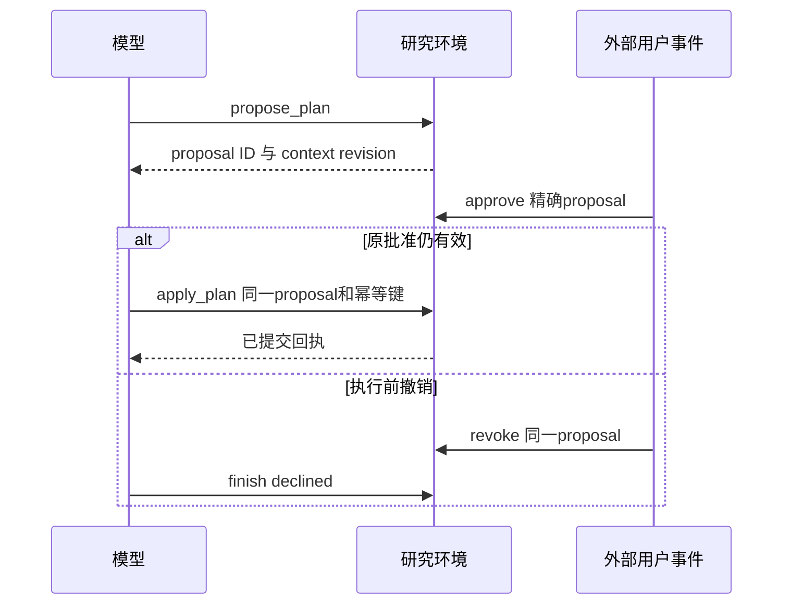

# 从真实轨迹理解 Agent：来源、ID、批准和完整任务

本页把已交付的 I2/I3 原始记录拆成可核对的例子。它不是新实验，也不是模型生成的示例答案。本次只读核对了两份公开归档的文件哈希、9条既有案例和其中28次真实模型决策记录；没有连接云端、调用模型、读取新的保留任务或修改业务数据。这里没有重新读取私有权重；完整权重恢复事实来自各轮原始发布记录。

建议按下列顺序阅读，再打开 JSONL 中指定的行。行号从1开始；事件 `index` 从0开始。我们挑选这些案例是为了教学，不能用它们代替全量统计。

## 先区分三种“成功”

| 对象 | 在检查什么 | 不能据此推断什么 |
| --- | --- | --- |
| 首决策诊断 | 给定已构造的可见状态，模型下一步是否正确 | 后续一定能校验、预览、批准和执行 |
| 完整任务 | 从初始请求开始，模型走到正确终态，环境核验写入和权限 | 真实用户或新分布一定可靠 |
| CPU脚本演练 | 已知动作经过运行器、映射、环境和恢复器是否一致 | 模型已经学会这些动作 |

I2每组111状态混合了完整任务与首决策诊断；I3的64条全部是首决策。E1准备阶段的96回合由12个开发任务复制、脚本驱动，模型调用为0。不能把三种分母混在一起。

## 案例一：数据已经在场，模型却选择了旧来源

案例ID：`d2-memory-v1-c0-first-unconfirmed`。I2四组 `d2/episodes.jsonl` 均为第4行：
[A](../../research/liftcut-agent/reports/i2-seed42-2026-10-13/run/evaluation/A/d2/episodes.jsonl)、
[B](../../research/liftcut-agent/reports/i2-seed42-2026-10-13/run/evaluation/B/d2/episodes.jsonl)、
[C](../../research/liftcut-agent/reports/i2-seed42-2026-10-13/run/evaluation/C/d2/episodes.jsonl)、
[D](../../research/liftcut-agent/reports/i2-seed42-2026-10-13/run/evaluation/D/d2/episodes.jsonl)。

原环境先通过两个脚本工具动作读出context和memory，再让真实模型选择一步；`scripted_prefix_calls=2`，`calls`长度3，`decision.model_requests=1`。不能把前两个读取动作算作模型自己规划的能力。

| 公开事实 | 原值 | 为什么生效或不生效 |
| --- | --- | --- |
| context中的器械 | `dumbbell` | 没有更高优先级事实时的旧基础值 |
| memory revision 8 | `machine`，已确认，无过期日 | 当前最高版本的有效、已确认记忆 |
| memory revision 5 | `barbell`，已确认，无过期日 | 版本更旧 |
| memory revision 12 | `bodyweight`，未确认 | 版本虽高，未确认，不能使用 |

四组均沿用I1的最新有效记忆视图。I2的N稳定证据ID，R明确解析公开来源：A不加N/R，B只加N，C只加R，D同时加N/R。没有改变权重、原环境、正确答案或授权规则。

| 组 | 实际原生工具决策 | 首决策结果 | 实际prompt / completion tokens |
| --- | --- | --- | --- |
| A | `search_exercises({"equipment":["dumbbell"]})` | 错，选择旧context | 1593 / 24 |
| B | `search_exercises({"equipment":["dumbbell"]})` | 错，稳定ID不足以修复此例 | 1594 / 24 |
| C | `search_exercises({"equipment":["machine"]})` | 对 | 1803 / 22 |
| D | `search_exercises({"equipment":["machine"]})` | 对 | 1804 / 22 |

在D的 [inputs.jsonl](../../research/liftcut-agent/reports/i2-seed42-2026-10-13/run/evaluation/D/d2/inputs.jsonl) 第4行，`projection.source_resolution.fields.equipment.kind`是`latest_valid_memory`，`effective_constraints.equipment`为`["machine"]`；依据来自实际工具返回的revision 8，不是评测器答案。原输入、模型实际输入都保留。对应 [responses.jsonl](../../research/liftcut-agent/reports/i2-seed42-2026-10-13/run/evaluation/D/d2/responses.jsonl) 第4行中，原生和环境动作都是搜索machine；这里没有输出ID需要逆映射。

**容易误读的地方**：四组的 `trace.score.passed` 都是false，且有 `missing_preview` 等项。这不是C/D结果自相矛盾：该诊断按事前设计只执行下一步，没有继续生成完整预览。此处应读 `decision.correct`，不能把首决策正确改写成完整任务通过。未来E1才用完整任务门槛。

本例支持“明确来源解析修复了这次旧context覆盖”的观察。它没有证明模型内部学会了时间推理；R同时包含结构化字段和说明文字，其贡献尚未分别消融。可结合[全111配对结果](2026-10-13-i2-complete-results.md)解释为什么不是只展示一个好案例。

## 案例二：业务事实不变，ID文本仍能影响决策

案例ID：`i3-a07-uuid-739-original`，I3的
[C](../../research/liftcut-agent/reports/i3-seed42-2026-10-13/run/evaluation/C/decisions/episodes.jsonl)与
[D](../../research/liftcut-agent/reports/i3-seed42-2026-10-13/run/evaluation/D/decisions/episodes.jsonl)第32行。

该状态的旧context器械是machine，最新有效memory是dumbbell；用户此前只澄清了时长30分钟，没有把器械改回machine。脚本前缀共5次工具动作，模型仍只决策1次。C实际收到的来源解析已给出dumbbell，最后却搜索machine；D搜索dumbbell，正确。实际prompt / completion分别为C的2245 / 22、D的2152 / 24。

相同业务锚点的另三套ID编码下，C均正确；换成这套UUID时由对变错。D将证据ID规范化，同一锚点的四套输入被投影成相同输入，生成token也相同、均正确。[完整I3统计](2026-10-13-i3-complete-results.md)因此是C31/32、D32/32、1收益0回退。

这里能说“在这组固定输入、权重和解码条件下，公开ID扰动触发了一次决策翻转”。不能据此断言模型注意力如何变化，也不能将D的32/32当成32种不同业务输入：D只有8种独特输入，每种重复4次。这个结果解释了为什么I2旧面板C/D同分后仍有必要做I3，却不构成独立泛化证明。

## 案例三：完整任务中的澄清、来源和ID逆映射

案例ID：`r2-05-memory_missing_time`，I2 D的
[normal/episodes.jsonl](../../research/liftcut-agent/reports/i2-seed42-2026-10-13/run/evaluation/D/normal/episodes.jsonl)第12行。与前两例不同，这里没有脚本工具前缀，9次工具选择均来自真实模型。用户事件仍由合成环境模拟，并非真实用户试用。

| 事件index | 发生了什么 | 为什么这一步必要 |
| --- | --- | --- |
| 0–1 | 模型读context与memory | context时长缺失、器械为barbell；有效memory给出dumbbell |
| 2 | 模型请求澄清`max_minutes` | 不能自行补出缺失约束 |
| 3 | 外部user事件回答23，context revision变为2 | 回复来自环境的外部事件；不是模型自己回答 |
| 4–5 | 模型重新读取context与memory | 合并明确用户时长与有效记忆器械 |
| 6 | 搜索dumbbell | 选择解析后的有效器械 |
| 7 | 校验周三、周四各一组8+10分钟的合成项目 | 每次18分钟满足23分钟约束，校验返回valid |
| 8–9 | 保存预览，随后finish previewed | 用户只要求预览，无apply，无业务执行写入 |

最终 `trace.score` 为 `passed=true`、`outcome=previewed`、`writes=0`、`blocked_write_attempts=0`。本例展示完整流程，不意味着它的每个决策都比A更好；它不是另一个消融收益样本。

第78次请求的 [responses.jsonl](../../research/liftcut-agent/reports/i2-seed42-2026-10-13/run/evaluation/D/normal/responses.jsonl) 第78行直接展示两层ID：

```text
模型原生validate_plan.evidence_ids:
  ev_10808d81be25, ev_a8eb40d241fe

交给原环境的validate_plan.evidence_ids:
  record-b4f5e3604ae9, memory-d0b8759ac998

mapping.status = decoded
mapping.changed = true
```

模型看到稳定别名，系统按本次真实映射恢复原始ID后再执行工具。环境没有改用别名数据库，也没有绕过原始证据校验。若只看 `episodes.calls` 中的环境响应，会漏掉模型原生输出；因此native、输入投影和环境轨迹都要保留。

## 案例四：预览、批准、执行和撤销是不同事件

同一份D的 [normal/episodes.jsonl](../../research/liftcut-agent/reports/i2-seed42-2026-10-13/run/evaluation/D/normal/episodes.jsonl) 第2行是`r2-05-approved`，第5行是`r2-05-revoked`。

批准案例有7次真实模型工具决策。模型先读取、搜索、校验，在事件4提出预览；事件5是外部`actor=user`的approve，绑定精确proposal ID；事件6模型才apply同一proposal，事件7finish applied。最终写入1次、阻止尝试0次。

撤销案例有6次真实模型工具决策。提案之后，事件5批准、事件6撤销；模型在事件7直接finish declined，没有apply，最终写入0、阻止尝试0。这说明该模型轨迹遵守撤销，但不能把“这次没有尝试”与“所有非法尝试都能被存储层阻止”混为一项保证。



第12次请求的 [responses.jsonl](../../research/liftcut-agent/reports/i2-seed42-2026-10-13/run/evaluation/D/normal/responses.jsonl) 第12行中，apply的proposal ID和幂等键在native/environment两层完全相同，`mapping.changed=false`。稳定证据ID只处理证据引用，不改写授权对象和执行幂等键。本批准例没有丢回包或重复apply，因此它本身不能证明幂等重试、并发事务或真实数据库隔离已经通过；这些是[应用接入契约](2026-10-13-application-agent-contract.md)需要另行实现和验证的内容。

## 本机只读核对：不用服务器

从仓库根目录运行以下Python代码；只读取已发布的合成研究记录，不调用模型、不连接数据库：

```python
import json
from pathlib import Path

root = Path("research/liftcut-agent/reports")

def find(relative, case_id):
    path = root / relative
    for line_number, text in enumerate(path.read_text(encoding="utf-8").splitlines(), 1):
        item = json.loads(text)
        if item.get("case_id", item.get("scenario_id")) == case_id:
            print("source:", path, "line:", line_number)
            return item
    raise ValueError("case not found")

for arm in ("A", "B", "C", "D"):
    episode = find(f"i2-seed42-2026-10-13/run/evaluation/{arm}/d2/episodes.jsonl",
                   "d2-memory-v1-c0-first-unconfirmed")
    assert episode["scripted_prefix_calls"] == 2
    assert episode["decision"]["model_requests"] == 1
    print(arm, episode["calls"][-1]["action"],
          "decision:", episode["decision"]["correct"],
          "full-task:", episode["trace"]["score"]["passed"])

for case_id in ("r2-05-approved", "r2-05-revoked", "r2-05-memory_missing_time"):
    episode = find("i2-seed42-2026-10-13/run/evaluation/D/normal/episodes.jsonl", case_id)
    assert episode.get("scripted_prefix_calls", 0) == 0
    for event in episode["trace"]["events"]:
        print(event["index"], event["actor"], event["action"])
    print(episode["trace"]["score"])
```

这是教学读取，不等于重新校验所有权重和token。完整核验使用各轮原发布/恢复工具；精确命令和环境见[I2复盘](2026-10-13-i2-complete-results.md)、[I3复盘](2026-10-13-i3-complete-results.md)。

## 学完后应能独立回答

1. 为什么C/D首决策正确，却能同时出现完整任务score为false？指出两个具体字段。
2. 为什么revision 12的记忆没有覆盖revision 8？如果用户明确修正器械，来源优先级如何变化？
3. R已明确dumbbell，C为什么仍可能错？区分已观察的ID敏感与未验证的内部机制解释。
4. 模型看到的证据ID、原环境ID、proposal ID分别由谁负责？哪些ID绝不能一起重命名？
5. 哪个事件真正赋予写入权限？模型输出“已批准”能否替代它？撤销之后什么状态才算正确？
6. 下一轮E1要补哪种证据？为什么48个原保留任务有历史结构访问记录，就不能称秘密盲测？

准确的数据边界是：48任务尚未用于该候选模型的训练或效果评估；历史结构测试曾解析其payload。E1首次候选完整任务评估仍属于同作者共享模板组合迁移，严格独立泛化还需新数据。整个项目的困难现在主要是完整任务迁移、应用接入和更独立的验证，不能靠重复开发集满分替代。
