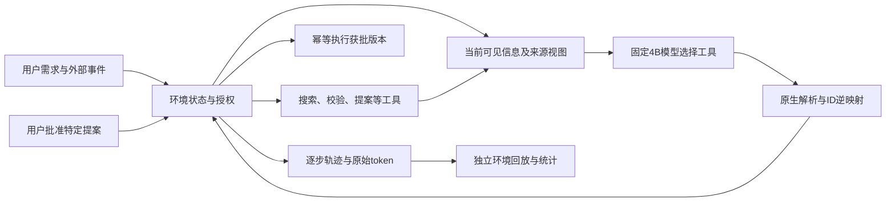

# 从一条失败轨迹讲清楚LiftCut Agent

这是学习路线，使用已经公开的合成开发轨迹；阅读和回放不调用模型，不连接服务器，也不修改真实用户数据。首先区分研究环境已有的完整工具循环和Web应用尚未完成的接入工作。

先读[带原始行号和可运行只读代码的案例拆解](2026-10-13-agent-case-walkthrough.md)：它逐步核对I2来源错误、I3的ID决策翻转、完整任务的澄清与证据逆映射，以及批准/撤销的两条真实轨迹。再用本页检查自己是否能独立解释。

## 先掌握这条证据链

环境负责判定动作是否合法、执行工具以及保存状态；模型负责从当前可见信息选择下一步。来源视图处理公开工具返回中哪些事实有效，不读取评测答案。环境拦住非法写入是一条安全事实，不能自动说模型自身从未尝试非法动作。

## 用真实I2错误解释改进

打开[I2逐例定位](../../research/liftcut-agent/reports/i2-seed42-2026-10-13/failure-localization.json)，搜索`d2-memory-v1-c0-first-unconfirmed`。A选择了原context中的`dumbbell`，而最新有效可见记忆是`machine`；这不是JSON解析失败，也不是缺少工具。数据在场，但信息来源优先级没有被可靠使用。

再看[I2配对复盘](2026-10-13-i2-complete-results.md)。只稳定ID的B仍留下6个来源错误；加入明确来源解析的C/D修复了这批错误。A/B/C/D为99/105/111/111，五条配对边没有回退。C/D同分只说明本批输入没有观察到N在R上额外收益，不能得出N对所有ID都没用；因此开展了事前固定D/C的新ID诊断。[I3](2026-10-13-i3-complete-results.md)真实出现C31/32、D32/32：唯一C错误在新的UUID编码下又选旧context，D保持正确。该1个收益不等于已证明普遍泛化。

理解三个边界：111包含首决策状态，并非111个独立完整任务；本轮没有新训练，改善来自系统输入处理；这些状态反复用于开发，48个保留任务尚未用于候选模型训练或效果评估，但历史结构测试解析过其payload，不能称为秘密盲测或把开发满分写成泛化准确率。详见[访问审查](../../research/liftcut-agent/reports/e1-data-exposure-audit-v1.json)。

## 一小时内独立走完

1. **10分钟：画职责图。** 对照[工具定义](../../research/liftcut-agent/src/liftcut_agent/interactive.py)，说出8个工具的输入输出，哪些动作只读，哪些改变环境。标出外部用户批准发生在哪里。
2. **15分钟：追踪同一条案例。** 从原可见context和memory，到A的原生tool call、D的投影输入、ID逆映射、环境动作和评分。每个断言都找到原始JSON字段，不能只背汇总分数。
3. **10分钟：解释一次失败。** 在`failure-localization.json`中区分“选旧context”“选其它记忆”“格式/预算故障”；说明哪种新实验能区分原因，哪种只是重复训练。
4. **10分钟：解释消融。** 用A/B/C/D分别说明N、R及交互；解释为什么负交互−6与0个回退可以同时成立。它反映修复重叠，不是新增6个失败。
5. **10分钟：解释复现。** 源码SHA、固定权重、输入/解码、逐例环境回放、原生token核验分别排除什么歧义；增量归档为什么必须实际读取父权重。上传回执与服务器消费是不同事件。
6. **5分钟：说出还没做的事。** 独立泛化、真实Web多步工具闭环、真实用户试用、DPO/RL、多模态均不能用这些结果冒充。

## 面试追问练习

- 为什么某些规则放在系统里？来源时效、授权、ID映射可以是确定性契约；不要把本可精确执行的约束都交给生成模型。模型仍负责在可见状态中选择工具并完成任务。
- QLoRA的价值是什么？展示先前配对训练和失败证据，解释初始化、mask、曝光/token预算及回退；不要把这次固定权重的111/111说成新一轮微调收益。
- 为什么不马上做RL或换大卡？先证明剩余失败是模型能力问题，再证明训练目标和数据能修复它。迁移与回执等待并不会因为GPU更快而解决。
- 如何反驳“只是调prompt”？展示正式假设、固定变量、配对消融、原始工具轨迹、权限边界、失败定位和独立核验，同时承认本轮R包含结构化来源字段与提示说明，尚未把两者贡献拆开。
- 如何逐步补证据？先在完整系统候选冻结后，一次性按预注册协议评估原保留组合，结论限定同作者共享模板迁移；更严格的泛化还需另建独立或外部许可数据。不能边看答案边改候选，再把同一批结果叫独立验证。

完成标准：关闭本页后，独立从一条原始轨迹说明问题、干预、对照、真实结果、局限和下一步，并能运行已有离线核验命令。代码由助手完成不替代这一步理解。
