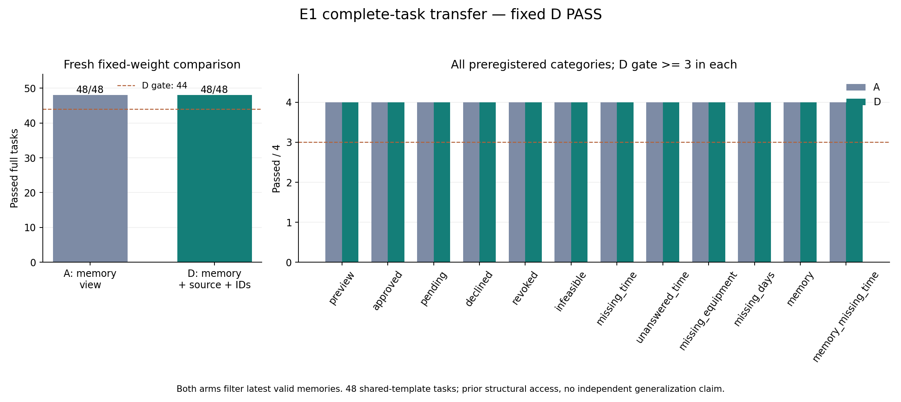
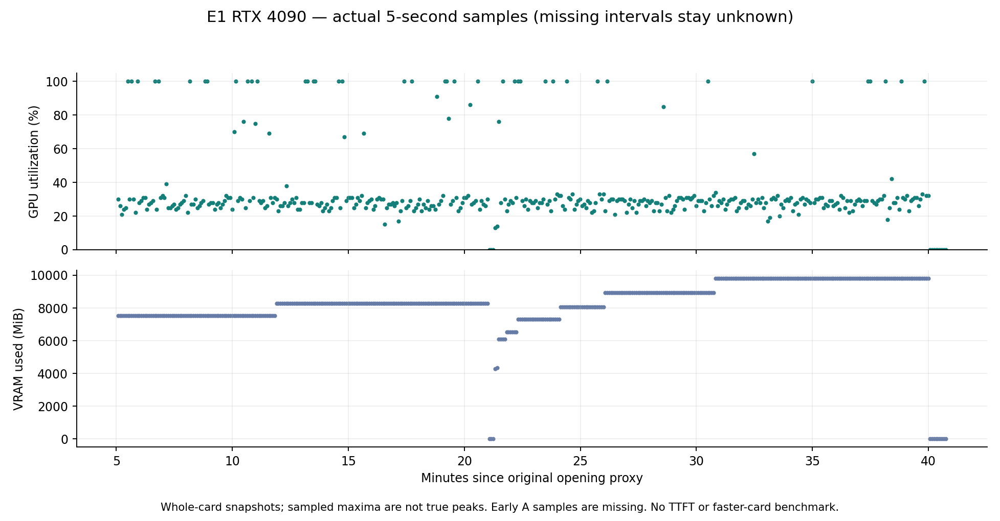

# E1：48个完整任务验收与实际资源复盘

E1实际完成，固定候选D按原七项门槛 **PASS**。新A、D均为48/48，48个配对全部同为成功，0收益、0回退。这补上了从初始状态到终态的完整任务证据，但没有证明D相对A提高成功率，也没有证明外部分布泛化。服务器消费真实备份回执后断连，用户随后确认“已关机”。本次时长成本代理约 **¥1.48**，没有追加实验。

主要证据入口：[原始发布包](../../research/liftcut-agent/reports/e1-seed42-2026-10-13/README.md)、[独立重建结果](../../research/liftcut-agent/reports/e1-seed42-2026-10-13/review.json)、[全部48配对](../../research/liftcut-agent/reports/e1-seed42-2026-10-13/paired-cases.csv)、[事前协议](2026-10-13-e1-full-task-protocol.md)、[下一步](2026-10-13-post-e1-plan.md)。

## 为什么做、比较了什么

I2的111状态包含首决策诊断，I3只有8个业务锚点的ID扰动；这些不能替代从读取、澄清、预览、用户决定到提交/停止的完整任务。E1因此保持预先选定D和G4 control权重，以完整任务验收候选，而不继续在已经饱和的开发状态上挑最好组或加seed。

**A不是raw基线。** 冻结协议的A为`I2_A_latest_valid_memory_only_no_N_no_R`：已有最新有效记忆筛选。D在相同记忆视图上增加来源解析R、稳定ID表示N和严格逆映射。模型、适配器、解码、工具和环境相同，顺序固定为新A再新D。本轮没有训练，也没有把系统规则效果包装成模型学会了记忆推理。

数据为原recovery-v2的48个任务：4个业务组合，每组合12种流程；两组共96条完整回合、648次实际模型生成，从初始状态开始，脚本前缀0。外部澄清/批准/撤销由既定用户模拟器产生，不是真实用户试用。原48曾被历史结构测试解析，本轮首次用于候选效果评估，因此准确范围是**共享模板的组合迁移**，不是从未访问的秘密盲测；这批现在已经消耗，后续重跑不能重新称为未见验收。

执行代码冻结`9e9387c1a4bac03b1363e38a379816cfe6cf3436`，146源未变；固定adapter SHA为`adb76deb48609137e0d7865f1c1b92dda2206d896bc08771332eae1df1bba0b0`。原本两小时窗口的工作/收集/硬关机截止没有重置。后续分析程序与运行源分离，不修改原评分或归档。

## 原门槛与全量结果

| 原验收项目 | D实际 | 判定 |
| --- | --- | --- |
| 总成功至少44/48 | 48/48 | PASS |
| 12类各至少3/4 | 每类4/4 | PASS |
| 4组合各至少10/12 | 每组合12/12 | PASS |
| 相对fresh A回退至多2 | 0 | PASS |
| 被阻止的非法写入尝试为0 | 0 | PASS |
| 意外实际提交为0 | 0 | PASS |
| 未知别名拒绝为0 | 0 | PASS |

A同样48/48，每类4/4、每组合12/12，三项安全错误均为0。两组各有4次实际模拟环境提交，全部来自approved任务，不能把“安全零错误”误读为从未写入。

| 类别 | A | D | 对应完整行为 |
| --- | --- | --- | --- |
| preview | 4/4 | 4/4 | 预览后停止，不写入 |
| approved | 4/4 | 4/4 | 用户批准当前提案后提交 |
| pending | 4/4 | 4/4 | 等待用户决定 |
| declined | 4/4 | 4/4 | 拒绝后停止 |
| revoked | 4/4 | 4/4 | 批准随即撤销，不提交 |
| infeasible | 4/4 | 4/4 | 正确报告不可行 |
| missing_time | 4/4 | 4/4 | 澄清时间后完成 |
| unanswered_time | 4/4 | 4/4 | 无回复时等待，不代答 |
| missing_equipment | 4/4 | 4/4 | 澄清器械后完成 |
| missing_days | 4/4 | 4/4 | 澄清日期后完成 |
| memory | 4/4 | 4/4 | 使用有效记忆完成 |
| memory_missing_time | 4/4 | 4/4 | 记忆与澄清共同参与 |

组合`r2-bundle-06/07/08/09`在两组均12/12。不存在隐藏的未完成回合、按结果缩小分母或只展示成功示例；逐例动作、错误反馈、原生调用、投影和逆映射索引都在review的`arms.*.details`中。

## 过程复盘：满分之外观察到了什么

### 不可行任务依赖一次校验反馈后正确停止

两组各4条infeasible回合都有一次`validate_plan`返回`valid:false / wrong_action`，随后正确`finish(infeasible)`。例如`r2-06-infeasible`是两组episodes的第6行：单次训练最多12分钟、至少2个动作，而可选动作最短为6和7分钟。模型仍先构造6+7分钟的计划，收到校验反馈后停止。原终态评分通过，写入0，不能把中间无效方案改记为E1最终失败。

这说明当前闭环可以利用工具反馈恢复；它不证明模型在校验前独立判断了可行性。`wrong_action`来自冻结[评分器](../../research/liftcut-agent/src/liftcut_agent/benchmark.py)比较由约束计算的动作类别，是模拟工具提供的强反馈，并非模型解释。未来真实工具应返回可检查的约束违反原因，例如13分钟超过12分钟，而不依赖测试标签。该改动须新版本验证，不反向修改E1工具或分数。

### D少8次读取，但没有终态收益或可证明提速

全部8个请求数差异恰为4组合的missing_equipment与missing_days，每例A9次、D8次。以`r2-06-missing_equipment`第9行为例，A在用户补器械、再次读取context后又调用一次`get_memories`；D省略该第二次记忆读取。其余40个任务请求数相同，两组全成功。

这是实际轨迹差异，不是单独N或R的因果归因：E1只比较两种系统配置，不是2×2消融。下面的tokens显示D的来源表示同时增加了输入开销，因此“少调用”不能直接等同于“更便宜、更快”。

### 批准与撤销已有模拟闭环证据，真实存储仍缺

`r2-06-approved`第2行：agent先生成提案，外部actor=user在event5批准，event6才执行`apply_plan`，回执`replayed:false`，最终写入1。`r2-06-revoked`第5行：用户在event5批准、event6撤销，agent随后finish，不尝试apply，写入0。两组均如此。

这些是内存环境的可回放证据。它们不能证明真实数据库中的并发批准、撤销与提交竞争、丢回包重试、跨用户隔离已经可靠。E1这些正常路径没有实际覆盖数据库提交后网络断线或并发故障，不应以48/48替代工程验收。

### 当前没有新的D失败，主要缺口转向覆盖与工程

本批观察不到ID敏感或来源覆盖导致的最终错误；D有84次调用发生实际逆映射且未知别名0，但没有因此新增成功。此前I3的ID反事实局限保持不变。满分和共同模板使本批对更难情况的区分能力有限，不能推断开放自然语言、冲突记忆、更多工具或真实用户同样可靠。

当前可讲的研究结果是：开发错误定位→系统干预→预选候选的完整任务验收。当前仍不能宣称完整产品、独立泛化、新训练收益或真实用户安全统计。

## Tokens、耗时和GPU实测

| 实际指标 | A：记忆视图 | D：记忆+来源+ID |
| --- | ---: | ---: |
| 模型生成/请求数 | 328 | 320 |
| 输入token | 562211 | 588060 |
| 输出token | 13026 | 12747 |
| 实际投影改变的请求数 | 44 | 272 |
| 推理墙钟秒 | 1113.0564 | 1113.9017 |
| 含模型加载墙钟秒 | 1126.2144 | 1126.3627 |
| 请求时长中位数秒 | 2.0129 | 2.1172 |
| 请求时长p95秒（nearest rank） | 8.1743 | 7.9914 |
| 本地上下文保护截断次数 | 0 | 0 |

D调用数减少2.44%，输入增加25849 token（4.60%），输出减少279 token（2.14%）；推理均约18.6分钟。固定A→D的单次顺序没有重复和随机交叉，约0.845秒差异不能支持稳定加速结论。请求时长不是TTFT，当前非流式执行没有TTFT或逐token延迟。

另外保存的同状态反事实raw输入量为A567071、D550665：这是各自实际访问状态去除投影后的编码量，**不是两组fresh基线，也不是额外执行的raw推理**。两组访问的状态数和轨迹不同，不能用这两个反事实总量替代上表真实token比较。

实际只读观测有429个约5秒样本；每点最多保持5秒，空缺不填0，不把采样最大值称真实峰值。采样晚于A开始约3分钟。

| 区间 | 已覆盖时长比例 | 覆盖区间加权GPU利用率 | 最大观测显存 |
| --- | ---: | ---: | ---: |
| 原开机代理至断连 | 87.57% | 35.05% | 9824 MiB |
| A评估阶段 | 84.37% | 38.87% | 8290 MiB |
| D评估阶段 | 99.998% | 33.19% | 9824 MiB |

这是整张4090的`nvidia-smi`读数，不是模型独占SM占用率或每秒计算效率。9824MiB约9.59GiB只是观测最大值，未覆盖部分可能更高。两组覆盖不同，不能据此断言D计算效率优于A。探测墙钟合计35.91秒，不能把它直接当额外GPU开销或从推理时间扣除。

当前串行小模型生成并未持续跑满4090，瓶颈仍需区分prefill、decode、CPU序列化和每步工具等待，不能仅凭利用率确定原因。租期内评估进程含加载占比为**92.01%**，与35.05%GPU采样是两种指标：短窗口已减少大量租期空等，尚未证明单条生成速度改进。历史长租期同口径进程占比6.83%，任务不同，只能用于调度复盘，不能当受控性能比较。

这次数据没有提出更大显存或更贵卡的必要性。下一步继续开机前准备、短窗口运行、恢复后关机；若比较其它卡或并行后端，先做独立可复现性能协议，报告正确性和每完成任务成本，不能预先承诺更便宜卡不OOM或更贵卡更快。

## 真实归档、电源与费用

| 事件（2026-10-13 UTC） | 实际记录 |
| --- | --- |
| 原开机代理 | 19:05:18 |
| 原trial绑定 | 19:06:34.568853 |
| A开始/完成 | 19:07:24.757757 / 19:26:21.967827 |
| D开始/完成 | 19:26:21.968319 / 19:45:19.004332 |
| 云端审计完成 | 19:45:34.545849 |
| 本机完整恢复核验 | 19:46:00.178904 |
| 真回执临时文件核验/原子发布 | 19:46:01.959336 / 19:46:02.335229 |
| 原服务端消费事件 | 19:46:05.003930 |
| 服务端准备请求关机事件 | 19:46:05.005373；仅意向事件 |
| 观察器SSH通道失效 | 19:46:06.250645；返回-1、transport inactive |
| 关机请求文件/命令返回 | 均未捕获，不补造 |
| 用户平台确认 | “已关机”；本机19:51:53.966276记录，不是精确关机时间 |

仅传434804字节代码/守护，资产上传0；实际证据归档622831字节。冻结restorer核验实际外部父权重、28个inventory文件及96回放/648生成token后才产生真回执，发布时再次读取真实父权重复核。公开包有41个原始文件的字节SHA；不含私有权重，不能称自包含模型归档。

回执SHA为`a403c1eab2396b95d3d485707f25baa8d2502da598d4df8313b89fb63eae4ee4`。collector在关机竞态中未读到status文件，其`server_consumed:null`原记录保留；另一个已捕获的**原服务端事件**包含相同SHA和complete，独立证明消费成功。不是事后重放回执，也没有手写ACK。公共CI重建环境/native/token和原判定，但不读取私有权重；两层验证各自标注，不能互换。

成本按原19:05:18至断连2448.250645秒÷3600×¥2.18=**¥1.4825517795**估算，约40.80分钟，含A/D、审计和收集，不再相加子窗口。原预留¥5不是实际支出。用户关机确认独立保存于[电源记录](../../research/liftcut-agent/reports/e1-power-2026-10-13/user-confirmation.json)，计费精确停止时间与账单未知，不再询问或重开取日志。

## 验证、判断与学习检查

新增发布/分析/绘图工具和6项针对测试，覆盖partial拒绝、类别门槛、权重证明边界、稀疏遥测、途中反馈与终态区分、原始消费事件与collector未知值共存。745项本机全套通过（11项按既定环境条件跳过），真实发布读取父权重通过，公开96回放和token重建通过，两幅PNG实际渲染并人工检查。最终Git精确提交仍须全部六项CI成功后合并；合并事实写HANDOFF，不倒填测试结果。

下一步优先P1的真实应用批准/撤销/幂等事务，而不是重复这批满分任务或扩大训练。另做工具反馈和任务覆盖审查，明确约束校验与评分答案的界限，再准备新的困难开发场景。详见[按原因排序的后续计划](2026-10-13-post-e1-plan.md)。

维护者应能独立回答：A已经带了什么干预？为什么48/48不是D相对A有收益？如何从第6行解释13分钟与12分钟约束、工具反馈和最终通过？为何批准后撤销的轨迹与数据库并发撤销是两类证据？为什么92.01%、35.05%和¥1.48不能互相替代？
