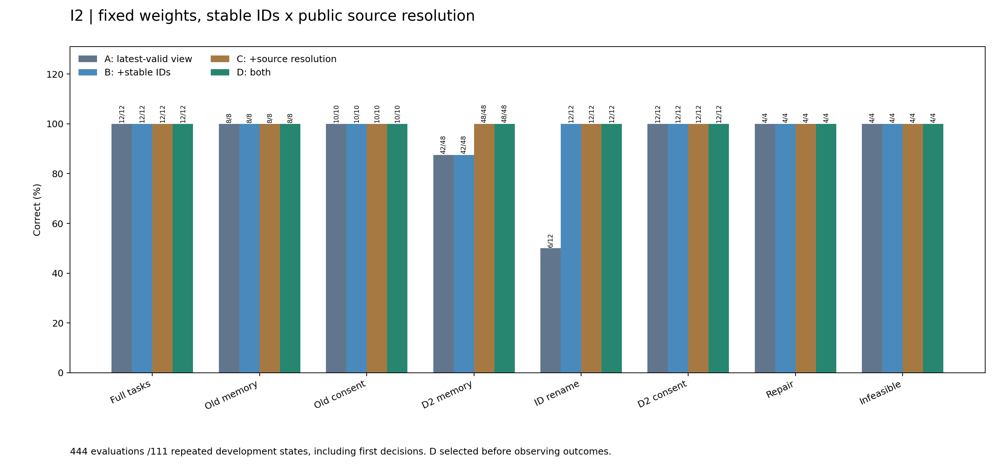
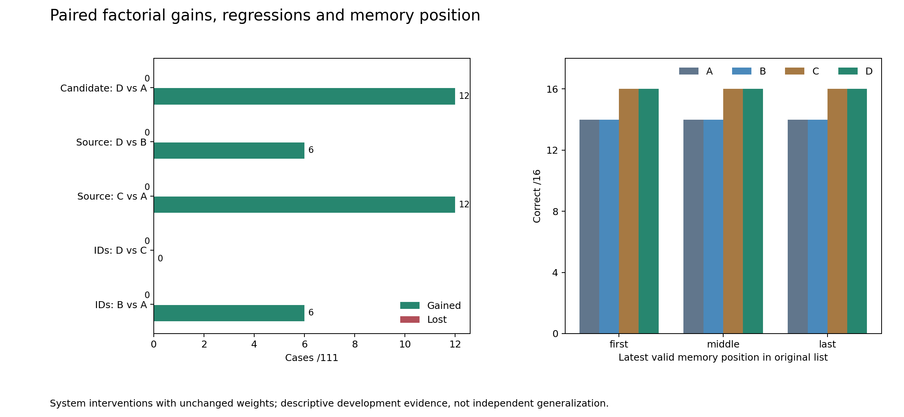

# I2 完整复盘：来源解析与稳定证据 ID

本轮四组真实推理、实际权重恢复和444条原环境/native/投影/逆映射/token回放均通过。事前指定的D通过原机制门槛和固定S0候选保护，具备进入后续验证的条件。**这是同一组反复使用的开发状态上的系统改进，不是新训练收益、独立泛化或产品上线验收。**

## 为什么开展、改变了什么

[I1](2026-10-03-i1-complete-results.md)把最新有效记忆提供给相同模型后，111状态从62到99，但仍有6个原始context覆盖有效memory的错误，以及6个仅改变公开ID就由对变错的情况。I2固定事前指定的G4新control权重，重新运行A对照；不能用历史I1替代本轮A，也不能看到结果后更换候选。

四组各111状态：A=I1最新有效记忆视图；B=A+稳定证据别名N；C=A+公开来源解析R；D=A+N+R。N只处理记录/记忆ID，并把模型输出逆映射回真实环境ID，不改授权或工具调用ID。R增加显式有效值及来源：用户明确更正优先，其次最新已确认未过期记忆，最后原始context。R同时改变结构化视图和说明文字，不能把收益进一步归因到其中某一项。

执行固定`acbba44cb16dce519823f2277206a8cdf3fcfca6`、116源、同一4B模型和实际adapter。没有新训练、种子搜索、付费API或48保留任务访问。科学条件见[事前设计](2026-10-12-i2-source-id-design.md)。

## 四组真实结果

| 评估内容 | A | B：+N | C：+R | D：+N+R |
| --- | ---: | ---: | ---: | ---: |
| 全部开发状态 | 99/111 | 105/111 | 111/111 | 111/111 |
| 正常完整任务 | 12/12 | 12/12 | 12/12 | 12/12 |
| 原记忆保护 | 8/8 | 8/8 | 8/8 | 8/8 |
| 原授权保护 | 10/10 | 10/10 | 10/10 | 10/10 |
| D2记忆首决策 | 42/48 | 42/48 | 48/48 | 48/48 |
| D2 ID改名 | 6/12 | 12/12 | 12/12 | 12/12 |
| D2授权 | 12/12 | 12/12 | 12/12 | 12/12 |
| 修复 / 不可行 | 4/4、4/4 | 4/4、4/4 | 4/4、4/4 | 4/4、4/4 |
| 误停 / blocked write | 0、0 | 0、0 | 0、0 | 0、0 |

111还包括1个首读诊断状态，不能把上述各面板当作111个独立完整任务。D的原门槛仍为记忆至少40/48、相对新A不退步，ID至少10/12且净增至少4，并保留其它保护与固定S0比较；本次均通过。A与历史I1 view的全部native请求和输出一致，是复现检查，不替代新对照。

## 全部配对收益、回退与因子解释

| 比较 | 收益 | 回退 | 实际修复的状态 |
| --- | ---: | ---: | --- |
| B−A：没有R时加入N | 6 | 0 | 六个`d2-identity-v0-c0-*` |
| C−A：没有N时加入R | 12 | 0 | 上述六个ID状态和六个`d2-memory-v1-c0-*` |
| D−C：已有R时加入N | 0 | 0 | 没有新增正确状态 |
| D−B：已有N时加入R | 6 | 0 | 六个`d2-memory-v1-c0-*` |
| D−A：事前候选相对新对照 | 12 | 0 | 两类剩余错误全部修复 |

每条边都审查了全部111行，而非只展示收益案例。N的平均净收益为3个状态，R为9个；交互项`D−C−B+A = −6`。这里负交互意味着两种干预修复了重叠错误、叠加收益小于相加；没有观察到个案回退，不能把它描述成两者互相伤害。C与D已经到达本开发集上限，因此本轮没有证据证明“有R时N仍提高准确率”，也不能因此事后把C换成候选。

## 错误原因定位与尚未回答的问题

A和B的六个记忆错误集中于rotation1、无澄清条件，跨三个位置和两类无效记录；实际选择了raw context值，未使用最新有效memory值。这是轨迹里能看到的来源竞争，不是对模型内部思维的证明。三种位置均为14/16；C/D均升至16/16。

A在12对业务内容相同、仅公开ID不同的输入中有6对成败翻转。B/D把12对实际投影输入变得完全一致，输出token也12对一致。C的12对实际输入仍不相同，但输出token均相同且全对：显式来源信息也可能缓解ID扰动。因此现有证据支持“系统表示修复了这些错误”，不支持“任何不透明ID都无害”或“别名对任意输入必有额外准确率收益”。

C/D在本轮没有剩余错误案例，但仍有三个研究缺口：仅覆盖既有开发业务与有限ID命名；R是复合干预；没有证明真实应用长流程或独立保留任务的表现。下一轮先检验新ID编码扰动，使用预选D和固定C消融，见[后续计划](2026-10-13-post-i2-plan.md)。不再对这111状态盲目加seed或继续训练凑分。

## 真实资源与操作缺口

| 组 | 实际生成次数 | prompt tokens | completion tokens | 模型推理秒数 |
| --- | ---: | ---: | ---: | ---: |
| A | 189 | 341,220 | 6,581 | 588.14 |
| B | 189 | 341,484 | 6,600 | 585.29 |
| C | 188 | 371,801 | 6,612 | 597.47 |
| D | 188 | 371,916 | 6,611 | 605.42 |

共754次真实生成。D的实际prompt比A增加约9.00%；没有稳定提速证据。报告中另有“相同已访问状态若使用raw输入”的反事实token，它不是重新运行A的成本，不能混在上表。生成次数变化也使本次单次总耗时不能直接作为严格速度基准。

真实启动05:34:46，D结束06:16:02，125,180,025字节完整归档06:44:52下载校验，冻结恢复器核验124个文件（含实际权重）及444条回放。真正回执SHA为`73cb287f2997c1f6a42824f44a653018128b7c2d23d3c229909e6eb0476dcc4e`，06:45:53原子发布，唯一collector于06:45:55退出0。全部发生在原06:54:46收集截止之前。

**原自动回执消费失败，不能写成成功。** 原控制器把等待终点取为“收集截止前30秒”和“备份完成后20分钟”的较早者，于06:36:55关闭实验流程并留下`off_instance_acknowledged=false`；完整下载实际约27分49秒，超过该内部等待。服务器按整夜授权仍保持开启，没有丢失模型证据。

原collector结束后，在原收集截止内执行一次独立只读验证：服务器06:46:56使用冻结验证器读取已经存在的真回执、索引和实际权重，并核验原电源guard，返回0。没有创建新回执、改写原false状态或修改远端文件。发布包同时保存原false记录与独立验证源代码/stdout/时间，严禁把后者追记为原控制器消费。后续运行必须修正等待策略，并避免重复下载未改变的权重；旧I2冻结源与原证据保持原样。

单I2启动至collector结束71.151分钟，费用代理¥2.5852；原04:27开机至此累计¥5.0476。两者重叠，不相加；整夜原截止15:00，预计累计代理¥22.999，不是账单。独立只读验证和后续工作仍计入同一租期，最终电源状态另记。

## 证据与复现

- [完整公开包](../../research/liftcut-agent/reports/i2-seed42-2026-10-13/README.md)：原始轨迹、回执、索引、操作证据；私有权重不进Git。
- [逐例/因子/成本复盘JSON](../../research/liftcut-agent/reports/i2-seed42-2026-10-13/review.json)、[来源与ID定位](../../research/liftcut-agent/reports/i2-seed42-2026-10-13/failure-localization.json)。
- 本机发布前重新读取实际adapter，公开CI独立重建444条环境/native/投影/token证据，明确不加载私有权重、不新增模型调用。两幅图已实际渲染并目视核对。
- [日志](EXPERIMENT_LOG.md)保留失败、解释、设计调整和学习检查；最终Git交付必须等待精确提交的全部六项检查成功。
