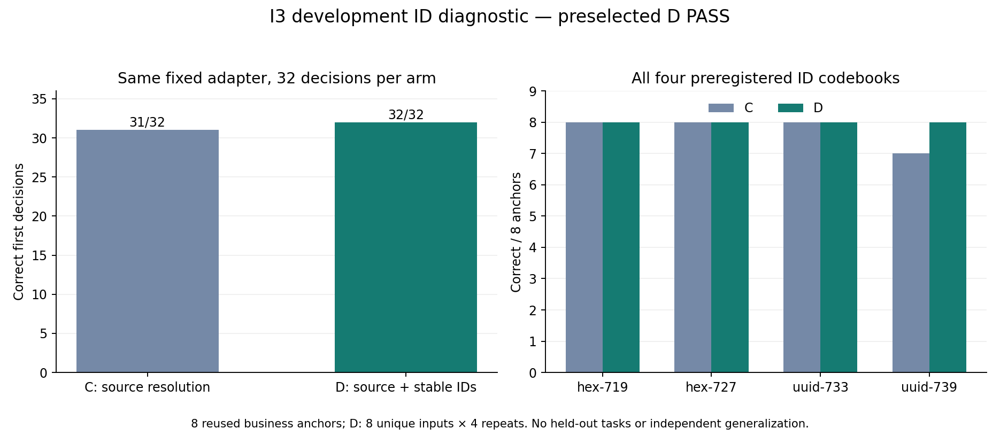

# I3真实复盘：新ID编码暴露C的一例旧来源回退，D保持32/32

本报告只统计2026-10-13真实运行`20261013-083235`，执行提交`2576cd3c0913fbdac122c0b216830c16ec80c5c1`。冻结128源没有在运行中改变。PR53精确提交六项检查成功后于08:31:39 UTC合main；首次080401的上传前失败、实际检查和路径修复仍在[启动复盘](2026-10-13-i3-startup-recovery.md)，不能算作模型实验。

## 为什么开展和保持了什么

I2四组A/B/C/D为99/105/111/111，C/D同分，尚未观察到稳定ID在来源解析之上的额外准确率收益。I3事前固定D为候选，C为消融对照，使用8个按结构选择的既有开发锚点和4套新ID编码；仅双射改名记录/记忆ID，不改业务事实、时间、授权、动作历史或工具。固定同一原G4 control权重、基座和解码，没有新训练。

每组32次首决策，共64次实际模型生成。C有32种输入；D规范化后只有8种输入，每种重复4次。这不是64个独立任务，也不是新业务分布。48个保留任务没有读取。[事前设计与原门槛](2026-10-13-i3-id-robustness-design.md)未因结果更改。

## 真实结果与逐例分析

| 指标 | C：来源解析 | D：来源解析＋稳定ID |
| --- | ---: | ---: |
| 正确首决策 | 31/32 | 32/32 |
| hex-719 / hex-727 / uuid-733 | 各8/8 | 各8/8 |
| uuid-739 | 7/8 | 8/8 |
| 锚点内ID变化导致的成败翻转组 | 1/8 | 0/8 |
| 实际不同模型输入 | 32 | 8 |
| 自主受阻写入 / 未知别名拒绝 | 0 / 0 | 0 / 0 |

D相对C **1收益、0回退、31同为正确、0同为错误**。原5项门槛全部通过：D32/32、0翻转组、0受阻写入、0未知别名拒绝、32次真实生成。该PASS只针对本诊断，不新增产品上线资格或独立泛化主张。完整32配对及8锚点分组见[可重建分析](../../research/liftcut-agent/reports/i3-seed42-2026-10-13/review.json)；[原始64行决策](../../research/liftcut-agent/reports/i3-seed42-2026-10-13/run/comparison.json)保留原生响应、环境响应、输入及输出token摘要。

唯一失败是`i3-a07-uuid-739-original`，对应`d2-memory-v3-c1-first-unconfirmed`：原context的设备为`machine`，最新确认记忆revision8为`dumbbell`，用户澄清的是`max_minutes=30`。C的实际`effective_constraints.equipment`正确为`dumbbell`，并有来源字段；模型仍调用`search_exercises({equipment:["machine"]})`，选回旧context。该锚点另外三套编码均正确。D四套编码的实际模型输入和输出token分别相同，全部选择`dumbbell`。

这里没有解析失败、预算故障或未知别名拒绝，且搜索动作根本不携带证据ID输出字段。因此直接证据是**无关ID改变模型输入后出现业务决策翻转**，不是ID逆映射把本来正确的动作改错。规范化阻断了本批ID变化进入模型输入，D修复了这一个配对。我们没有测量内部注意力，不能进一步声称已经证明某个神经机制，也不能凭一个相关锚点推断普遍效果大小。

按业务分层，C仅rotation3、需要澄清的组合留下1错：该rotation为7/8，澄清层15/16；其它rotation各8/8、无澄清层16/16。D各层全部正确。位置和无效项在本轮固定为最新首位/未确认干扰，不能把本轮结果推广到未测分层；其它位置证据仍来自I2。

## 成本和执行证据

| 项目 | C | D |
| --- | ---: | ---: |
| 实际生成数 | 32 | 32 |
| 实际prompt tokens | 64,521 | 63,300 |
| 实际completion tokens | 734 | 736 |
| 推理墙钟秒 | 70.826 | 71.501 |
| 含模型加载秒 | 82.345 | 84.754 |

D的prompt比C少1,221（约1.89%）；本次推理并未更快。单次顺序运行和相关重复输入不能证明稳定提速。[分析JSON](../../research/liftcut-agent/reports/i3-seed42-2026-10-13/review.json)另列同一访问状态的反事实原输入token，它不是一组新raw模型运行，不能与实际C/D混用。

实际trial08:33:45.394286 UTC，原工作/收集/硬截止08:53:45 / 09:13:45 / 09:18:45，没有延长。C于08:35:25完成，D于08:37:04完成，服务端审计和增量包08:37:15完成。归档215,710字节、SHA `b9550874b34189075c40bd29ac10dfb3f14a38a95f98c2b1b8ae460f7230538e`。

冻结恢复器核验28个实际文件、64条原环境/native/投影/逆映射及全部生成token，并**实际读取核验原I2父适配器**后生成真回执。这个增量包不是自包含，不能只拿公开metadata声称重验了私有权重；完整公开发布有38份原始哈希绑定文件。[发布清单](../../research/liftcut-agent/reports/i3-seed42-2026-10-13/publication-manifest.json)记录此依赖。

回执SHA `856b9824b8fb072829f871b61b01378130068826f84644ddbebbf348d6f82fe9`：08:37:35.607525临时上传读回核验，08:37:35.998097原子发布，服务器08:37:37.512436实际消费，08:37:37.513361记录保留实例，唯一collector19321于08:37:44.473843结束并退出0。上传与消费分别有原始事件。I2旧消费者提前退出的false历史仍保留，I3成功不能改写它。

本轮实际trial到收集239.080秒，按¥2.18/h为¥0.1448代理；原04:27开机至收集的整夜累计为¥9.1103，已经包含本轮，**不相加**。到原15:00截止仍约¥22.999，规划¥25。实例按用户要求继续保持；这不是平台账单或已关机声明。

## 解释、下一步和学习检查

I2旧面板同分与I3新ID编码出现1收益可以同时成立：稳定ID的价值没有在旧范围被测出来。保留事前D作为系统候选有了更直接的证据，但候选仍依赖确定性来源解析；不能改写成模型学会记忆时序推理。

当前D在I2与I3观察范围内没有剩余错误。下一步不再围绕同一8个锚点刷更多编码或seed，也不为用完租期追加同类实验。先把完整系统候选、一次性独立验收协议与真实应用接入契约做成可检查材料；48保留任务本夜继续封存。R中的结构化来源字段和说明文本仍未拆分，这是一项可另行预注册的机制问题，但其收益低于独立验收和产品闭环，不在本轮事后加组。见[后续安排](2026-10-13-post-i3-plan.md)。

675项全套离线测试149.422秒通过，5项发布针对检查通过；发布器再次实际核验父权重，分析器独立重建真实64条，CI仅做公开metadata/native/token重建并明确不读取私有权重。图表已实际渲染查看。最终Git交付须本结果提交全部六项检查通过后合main，不能用PR53执行检查替代结果检查。

学习检查：能从原始C/D最后一条输入指出相同的业务事实和不同的ID，再从实际原生输出解释为什么得分不同；能说明32次生成与8种不同输入的区别，以及为什么1个收益不能称为普遍泛化。
