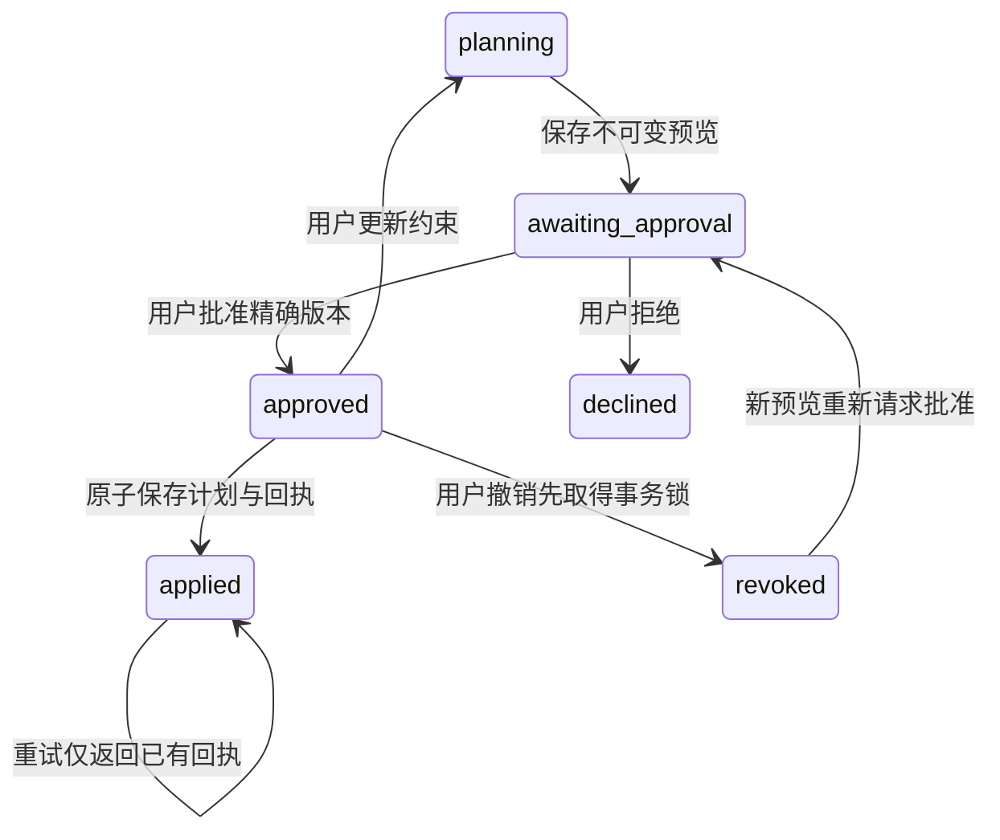

# P1：批准、撤销、事务写入与重试的实际应用路径

2026-10-13。本增量依据[E1后计划](2026-10-13-post-e1-plan.md)和用户“先把真实应用流程做好并验证”的指令实施。`p1-app-v1`已经接到 Next.js 页面、登录校验、API 和真实 PostgreSQL 事务；**验证发生在本地开发数据库，未迁移生产数据库，未接固定D推理服务，没有新模型分数或GPU开机**。

## 为什么先做这一层

E1的96完整模拟回合不证明数据库并发、浏览器失联或进程退出正确。原生成/手工保存路径按多个HTTP请求写计划、周、天和动作，缺少绑定精确预览的批准事件、原子回执和幂等约束。直接把它命名为Agent的`apply_plan`会隐藏这个差距。

本次增加独立事务入口，保留既有手工保存路径的语义；不能据此宣称所有历史保存接口都已事务化。模型将来只取得绑定当前用户/run的[工具端口](../../src/services/agent/tool-port.ts)，不取得Cookie、数据库连接或批准/撤销能力。当前页面导入已有AI草稿或人工JSON，原始事件标记`draft_import`，没有伪装成D生成。

## 已实现的边界

- [页面 `/plan/review`](../../src/components/plan/agent-approval.tsx)显示完整计划、当前约束、预览版本、指纹和操作记录。已有AI计划页新增“检查版本并批准保存”入口；明确批准后还需执行。刷新时查询原run；创建响应丢失时保留原请求键和内容，避免再建一条流程。
- [API](../../src/app/api/agent/runs/route.ts)复用服务端`auth.getUser()`，不相信body里的user_id。写路由检查同源、JSON类型及实际256KiB读取上限；跨源403、未登录401。模型端口没有用户决策方法。
- [契约](../../src/lib/agent/contracts.ts)以`proposal_id + content_hash + context_revision + approval_id`绑定实际批准。提案、事件、执行键和回执对运行角色只可追加，不能更新或删除。旧版本批准、上下文更新、真实账户资料变化都不能沿用旧授权。
- [事务实现](../../src/services/agent/store.ts)使用一个`pg`连接执行BEGIN/COMMIT，按用户取得事务级锁，再锁run及实际资料行。保存计划和所有子行、更新激活状态、产生回执与提交事件在同一事务内完成。三个子表采用批量插入，避免每个动作一次数据库往返。
- [迁移](../../supabase/migrations/20261013203030_p1_application_transactions.sql)使用私有schema与无BYPASSRLS的独立运行角色。浏览器的anon/authenticated不能访问私有表；所有者RLS约束业务表和新表。运行连接拒绝管理员角色。唯一约束限制每run一份回执、每用户同一执行键，以及每用户至多一个激活计划。
- 同键同意图返回原回执；同键异意图冲突。即使用新键重试同一已批准提案也返回原提交事实，不能写第二份。执行尝试与真正业务提交分开计数；本版每run最多64次尚未完成的执行尝试，已知回执仍可查询。
- SQL写入错误在保存点回滚业务修改，包括旧计划的激活状态；保留尝试与回滚事件。连接中断保留`OUTCOME_UNKNOWN`，没有自动重开流程或假成功。提交之后的撤销不声称能够倒退历史事务。

数据库连接属于受信任的应用服务。RLS不是对已被攻陷的应用服务的隔离承诺；服务能够设定已验证用户GUC，因此连接字符串绝不能给模型、浏览器或用户输入。提案哈希和回执也不是外部第三方签名。

## 实际验证与证据

[原始证据入口](../../research/liftcut-agent/reports/p1-application-2026-10-13/README.md)包含22项测试日志、24逐工作流输入/结果/完整数据库快照、浏览器测试与截图、恢复证据和SHA。不同层的检查不能相加成“模型成功率”。

| 实际检查 | 结果 | 能证明什么 |
| --- | --- | --- |
| PostgreSQL16.15 + 受限运行角色，22项工程测试 | 22通过；12个同键并发执行只写1份 | 实际锁、事务、RLS、同键/异键、跨用户及错误处理 |
| 数据库故障触发器，在动作写入阶段抛错 | 旧计划仍激活；新计划/子表/回执均回滚；同键重试成功 | 不是只模拟HTTP错误，真实部分SQL写入不会泄漏 |
| 实际子进程提交后被强制结束 | 新进程读回原回执；重试仍1份业务计划 | 持久化不依赖某个Node对象/内存；另有独立连接池恢复测试 |
| 更新实际资料未提交时发起执行 | 更新先完成后旧批准被拒绝，写入0 | 授权判定与资料行锁的顺序 |
| 8种流程×3业务约束，脚本驱动真实数据库 | 24/24预期终态；18执行尝试、9提交 | 应用端工作流基础；0模型调用，不是P1-M成绩 |
| `pg_dump`→新数据库`pg_restore`→受限角色读取 | 24个完整快照及回执逐项相同，仍9提交/18尝试 | 真实数据库备份恢复；不是模型归档ACK |
| 浏览器→Next API→真实PG；提交响应被主动丢弃 | 刷新查询恢复原回执，数据库只有1份计划 | 页面未收到成功响应也不会误写第二份 |
| 浏览器撤销后，额外发送旧执行请求 | 409 NOT_APPROVED、回执为空；改约束后旧预览过期 | 界面禁用按钮之外，服务器也拒绝旧动作 |
| 原有应用回归 | 8+39项通过 | 原有业务测试保持通过 |
| E1冻结源 | 146源哈希保持一致 | 新应用工作未改写既有实验条件或结果 |

浏览器3项测试的认证边界：本地HTTP服务返回合成的Supabase身份/资料，并为既有计划页提供PostgREST读取协议的测试适配器（行数据来自同一真实数据库）；页面和API实际调用`getUser()`；**它不是GoTrue、真实用户登录或生产Supabase验收**。事务使用真实PostgreSQL、真实登录角色与RLS，P1接口没有被mock。数据库schema里的`auth.users/auth.uid`也是明确的本地兼容fixture。生产Cookie、代理域名、连接池/TLS和托管权限仍需部署前单独验收。

24工作流中`lost_response`脚本只丢弃函数返回值；实际网络丢包由独立浏览器测试覆盖。`resume`脚本重建对象；真正的进程退出由独立child-process测试覆盖。不会将这两种较弱脚本证据冒充故障注入。

恢复使用149965字节的本地custom dump，SHA `a69176810acae86c081a549c93e8c2d1d744d800689e56546b70512b587c67eb`。dump包含本地合成测试库，未上传；公开的是本24流程的合成快照和实际恢复记录。该记录没有关机、模型权重、token核验的含义。

## 每一步遇到的问题与原因

1. **本地存储环境。** Docker Desktop启动在Inference manager/文件路径处失败，未反复启动；改用WSL Ubuntu PostgreSQL16.15。首次WSL命令退出后转发不可用，保留一个本地会话稳定集群，而不是误判为应用连接实现失效。无云端连接。
2. **初始化脚本。** `tsx`以CJS解析导致顶层await失败，改为显式async入口；原schema有UTF-8 BOM，送给SQL解析器前只去掉开头BOM。失败数据库保留，新建dev2验证，不把失败初始化记为通过。
3. **核心验证。** 先15项实际数据库检查，再补同源/请求大小/模型能力端口4项；最后增加真实进程退出、危险角色拒绝与资料锁顺序3项，最终22项通过。
4. **浏览器测试。** 首轮把现有登录后的`/onboarding`错误假定为`/`，同时测试身份服务漏了CORS方法；修正测试契约。后续alert选择器与Next路由播报器重名，改为选择明确的错误文本。这些是测试故障，不写成数据库并发漏洞。实际提交丢响应/撤销流程随后通过。
5. **页面检查。** 实际渲染后发现约束标签窄行折行、预览只展示JSON；改为纵向标签和按周/天/动作的人可读计划，完整数据仍可展开。修正执行后查询误用可编辑恢复编号，固定查询刚才实际执行的run。进一步检查发现原计划页读取客户端缓存；保存后“查看计划”先刷新实际业务数据，再导航。浏览器测试额外验证实际计划名和动作出现，测试HTTP读取适配器按原查询的eq/in/limit筛选真实业务行，避免把多份历史计划混为一份。
6. **恢复。** 24流程真实运行后做custom dump，在独立新数据库恢复，再比较原始快照和受限角色API读取结果。恢复失败不能改成partial通过；本次实际全部匹配。
7. **SQL检查。** 初次Supabase CLI lint缺`plpgsql_check`扩展；安装本地检查包后再运行，`agent_private`返回无schema错误。该命令不等于托管Supabase完整安全顾问扫描。
8. **本机效率。** 全量ESLint扫描了历史安装/恢复副本，产生44条重复历史警告；增加对已忽略`research/liftcut-agent/outputs`的ESLint/TS排除，仍检查全部当前源和测试。历史归档由独立SHA/回放检查负责。最终只剩2条原有源文件警告；当前源检查实测10.22秒（无严格前后耗时基线，不能报百分比提速）。没有宣称已测GPU提速。

所有改动在独立`feat/p1-application-transactions`分支。增加`p1-database` CI作业，包括真实Postgres、24流程备份恢复和浏览器；因此最终应核对**七项**检查，不能沿用E1六项。最终Git状态以HANDOFF为准。

## 本地重现与部署边界

1. 创建专用、可丢弃、名称以`liftcut_p1_`开头的本地Postgres数据库，把管理员URL放入`P1_TEST_DATABASE_URL`。测试入口拒绝非loopback/非测试库，初始化拒绝已有P1表。
2. `npm ci`；`npm run test:p1:setup`。它加载测试身份兼容层、已有`supabase/schema.sql`和新迁移。代码中的固定密码仅用于本地合成fixture，不能用于托管环境。
3. `npm run test:p1`；`npm run p1:rehearse -- <新目录>`；`npm run p1:audit -- <同目录>`。输出目录必须不存在；逐例证据不会覆盖已有结果。
4. 设置同库受限角色`P1_RUNTIME_DATABASE_URL`，`npx playwright install chromium`，`npx playwright test --config playwright.p1.config.ts`。Windows可用`P1_BROWSER_EXECUTABLE`指定实际本地Chromium路径。测试只连接loopback，AI provider指向不可用本地地址，没有付费API。
5. 用同版本Postgres的`pg_dump --format=custom`和`pg_restore --exit-on-error`恢复到新测试库，切换管理员URL后再次运行audit，既比字节，也比实际数据库和回执。

生产/托管迁移尚未执行。新迁移是**已有schema之上的增量**，不是空库初始化方案；CLI config只列public/graphql_public，不能暴露agent_private。发布前核对现有表结构、用户激活计划重复项（唯一索引会拒绝已有冲突，不自动删数据），备份后用迁移管理员应用；单独配置随机凭据的`liftcut_agent`登录。`AGENT_DATABASE_URL`必须是与Supabase身份/业务表相同的数据库，且是服务端专用、支持完整事务的连接，不使用postgres/service_role管理员。托管项目的直连或事务连接池、TLS证书和实际auth.uid行为需在隔离环境核验。这里没有执行任何生产数据修改。

目前校验仅覆盖schema、训练天数与声明时长，不推断自由文本动作的器械兼容或身体适宜性。所有完整批准内容仍存提案，映射到旧业务schema时目标、提示、周重点、时长与休息信息保存在notes。中文审核页先用于本次研发验收，尚未完成多语言产品打磨。

## 下一步

[P1-M具体准备与门槛](2026-10-13-p1m-preparation.md)继承24工作流但单独记录真实模型调用；新应用输入/工具契约需要版本化，不能把当前D的研究模拟器直接换API地址。当前尚无安全的模型连接器、原生token归档/重放及新独立窗口执行冻结，`gpuReady=false`。服务器继续关闭，先补这些本机准备，不用GPU等待工程联调。

学习检查点：沿`p1-1-lost_response.json`的批准、execute、retry_same_key和数据库receipt，解释18次尝试为什么只产生9次提交；解释撤销与执行竞争以数据库顺序为准，为什么回执时间是事务内记录时间而不是独立观测的COMMIT完成时间。

实现参考：[node-postgres事务连接要求](https://node-postgres.com/features/transactions)、[PostgreSQL锁语义](https://www.postgresql.org/docs/current/explicit-locking.html)、[Supabase RLS](https://supabase.com/docs/guides/database/postgres/row-level-security)。本实现采用其中适合当前单流程的事务和权限边界，没有引入额外Agent编排框架。
