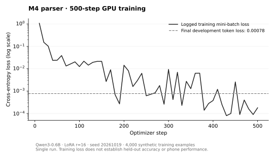

# M4 首次完整 GPU 实验 · 2026-10-19

完成一次 Qwen3-0.6B LoRA 训练、合并模型与 Q4_K_M 各 1,060 条评测、量化导出和完整备份恢复。量化 JSON 一致性为 **946/1060（89.25%）**，原定 95% 门槛**未通过**。模型仍会在应当追问的语句上补填值，**没有达到直接接入产品记录的条件**。本次未更改线上聊天、确认流程或真实用户数据。

## 固定协议与来源

- 执行源码：`20a610901fdd119b76cf175d84bf577fe4b10237`；文件树 `72b8ad1cae89b5e5a28e7afe38e23ae5f3332ff4`。当时该提交 7 项 GitHub Actions 通过；Vercel 网页发布受当日频率限额阻挡，训练不依赖网页部署。
- 基座：`Qwen/Qwen3-0.6B`，修订 `c1899de289a04d12100db370d81485cdf75e47ca`，Apache-2.0；从 ModelScope 下载后核对既定 7 文件 SHA-256。
- 4,000 条训练、500 条同模板开发、500 条留出模板测试、60 条手写评测。数据与[既定清单](../../data/manifest.json)一致，评测样本未进入训练。标签先行、模板合成，**没有使用真实健康记录或本轮教师模型标注，不称为已验证的教师蒸馏**。
- LoRA r=16、alpha=32、dropout=0.05；lr=0.0002、batch=16、2 轮、500 步、seed=20261019、最长 512 token；仅答案 JSON 计损失。CUDA / bfloat16 训练指标为 **144.4 秒**，最终 dev token loss **0.00078**。这不是答案准确率。
- AutoDL RTX 4090 24 GB，16 vCPU Xeon Gold 6430、120 GB 内存；Python 3.12.3、torch 2.8.0+cu128、CUDA 12.8、transformers 5.20.1、peft 0.21.2。实际依赖及源码哈希见 [runtime-audit.json](runtime-audit.json)。
- 一次固定运行；没有追加种子、改提示、重训或根据测试分数调阈值。原 4 小时实例截止保持，预留 20 分钟收回；流水线超时与独立关机守护分别配置。实际守护命令失败后的控制台收尾见下文。

## 原始评测

| 系统 / 执行设备 | 集合 | 完全一致 | 字段准确率 | 多填字段数 | schema 合法率 | 完整生成 p50 / p95 (ms) |
| --- | --- | --- | --- | --- | --- | --- |
| 合并模型 / GPU | dev | 494/500 (98.80%) | 0.9976 | 12 | 1.0000 | 876.1 / 2976.6 |
| 合并模型 / GPU | 留出 test | 375/500 (75.00%) | 0.8478 | 141 | 0.9240 | 968.1 / 2893.8 |
| 合并模型 / GPU | 手写 | 50/60 (83.33%) | 0.8759 | 12 | 0.9000 | 587.0 / 2257.9 |
| Q4_K_M / CPU | dev | 487/500 (97.40%) | 0.9843 | 3 | 0.9840 | 886.6 / 2193.9 |
| Q4_K_M / CPU | 留出 test | 376/500 (75.20%) | 0.8731 | 154 | 0.9000 | 1052.1 / 2293.5 |
| Q4_K_M / CPU | 手写 | 48/60 (80.00%) | 0.8346 | 13 | 0.8667 | 670.7 / 1768.3 |

“完全一致”是模型标签按当前会话解析后的结果与标准答案一致，不是原始 JSON 文本相等。`invented` 只统计标准答案不应有而回答填出的重量、单位、次数、RPE、组数或位置等字段；它不是错误案例数，也不覆盖所有错误值替换。字段准确率与遗漏率不含标准答案为追问的行，应结合完全一致和追问召回一起读。完整指标、各类分数和前 40 条失败见 `metrics-*.json`。

既有[规则基线](../README.md)在同一 test 上为 142/500、多填 6 个字段，手写集 24/60；本轮合并模型 test 为 375/500、手写 50/60，但多填值也增加，不能只用完全一致率宣布产品更安全。没有补跑 DeepSeek 云端基线（此前凭据 401），也没有未经微调的基座对照，所以不主张对云端或基座的净增益。

### 量化与速度的边界

- Q4_K_M 大小 **396,704,512 bytes（约 396.7 MB / 378.3 MiB）**；f16 GGUF 为 1,198,182,144 bytes。[sha256.txt](sha256.txt)记录 adapter、合并权重及两份 GGUF 的 4 个哈希。
- 量化前后原始文本相同 943/1060，可解析 JSON 相同 946/1060，缺失 0；95% 阈值未调整，运行状态为 `done-consistency-below-threshold`。一致性不等于正确性：两边都答错也可一致。
- [逐条配对诊断](paired-diagnostic.json)显示 test 有 342 条两边都对、33 条仅 merged 对、34 条仅 Q4 对、91 条两边都错；375 → 376 的净变化不能掩盖 33 条回退。此事后诊断不替换预先约定的 JSON 一致性门槛。
- 两边使用同一 tokenizer 渲染、贪心逐句生成。合并模型在 GPU 上，Q4 在服务器 CPU 上，计时不含模型加载及预生成输入模板；不是手机首字，也不能作为同硬件量化提速对照。
- **本轮 Q4 的生成线程为 4，预填充未显式设置，llama-cpp-python 0.3.36 按可见宿主机 128 核取默认值；实例 CPU 配额 / 进程亲和范围均为 16 核。**本轮未中途改动，不能称为严格四线程测试。
- 已修复未来运行的 `predict.py`：`--threads` 同时传给 `n_threads` 和 `n_threads_batch`。新回归在旧实现中复现默认 4 / 显式 2 都仍预填充 128；线程与编码回归合计 Windows 2 项、Linux 全部 11 项通过。未追加模型推理测量线程修复的速度收益。
- 实际 tokenizer 计数：1,060 条输入中长提示平均 380.21 token、短提示 69.21，减少 81.8%；仅分词计数，没有对应的手机延迟实验，见 [prompt-token-audit.json](prompt-token-audit.json)。

## 错误诊断与下一步

观察到开发集准确率高但留出句式下降；这说明同模板成绩不能代表真实口语泛化。具体失败包括缺单位时猜单位、少次数时仍生成记录、RPE 越界，以及 Pull-up 与 Push-up 等动作混淆。严格 JSON / schema、数字出现检查、动作属于当前列表，分别只能覆盖部分问题。

对原有 500 条 merged test 预测追加已有 schema / 数字单位拒绝规则的**事后回放**，完全一致由 375 变为 422，多填字段从 141 降至 93，但遗漏率从 0.1515 升至 0.1793，仍不达标。这是候选系统守卫的诊断，不是新的模型分数、独立验收或已经上线的防护。原始分数保留。

下一步为共享端侧草稿协议和确定性守卫：核对原话中的动作、单位、数量与字段对应关系，区分实际、计划、否定和不确定表达；“同上”只能引用确认过的实际值。继续走共用版本检查、幂等写入、补偿撤销和用户确认。确认卡不能代替这些检查。通过后再做原生模型加载、断网和真机性能验证。后续训练或提示调整应另建未参与调试的留出集，本次 test 已用于诊断，不再作为未见验收。

当前只运行一次、一个种子；模板合成与 60 条手写不代表真实用户分布。尚无原生 App 推理、模型公开下载源、实体手机 / 微信 / 国内运营商性能结果。E1/I2/I3 冻结研究未改动。

## 用时、备份与关机

| 阶段 | 秒 | 退出码 |
| --- | --- | --- |
| env | 0 | 0 |
| python | 186 | 0 |
| base | 148 | 0 |
| data | 25 | 0 |
| train | 152 | 0 |
| eval-merged | 1167 | 0 |
| export | 21 | 0 |
| eval-q4 | 1199 | 0 |
| consistency | 0 | 0 |
| hashes | 12 | 0 |

流水线实际 2910.0 秒（48.50 分钟），不含开机后的连接准备、归档传输与恢复。完整权重与日志已保存在维护者本机，并与实例数据盘副本分开保留。4 个归档按大小和 SHA-256 校验、2,120 条预测的 ID 完整性核对、6 份评分完全重放匹配、4 份权重逐项哈希匹配后才发送关机回执。完整性通过与模型质量达标分开判断。

AutoDL 控制台已核验本次实例**已关机**；按观察到的开机至平台关机确认时间与 ¥2.18/小时换算，计算时长代理约 **¥2.46**，不是平台账单。未释放实例、未删除旧数据或升级资源。

收尾保留两个实际失败：Windows 重放时，`consistency.py` 使用默认 GBK 写中文，UTF-8 读回失败；指定 UTF-8 重放后六份分数和一致性完全匹配，并给脚本补上显式 UTF-8 和非 UTF-8 环境回归。随后关机守护消费了有效备份回执，但 Python 直接执行实例内 `/usr/bin/shutdown` 得到 `Exec format error`，未成功关机；按既有授权改用 AutoDL 控制台关闭指定实例并核验“已关机”。不把守护已部署或发出关机请求当成平台关机证据。

公共证据包含本目录指标、运行配置、权重 / 原始预测 / 归档哈希和 [recovery-verification.json](recovery-verification.json)。原始预测、完整日志和模型权重保存在本机备份，未发布进 Git；仅凭公开指标不能独立重放完整输出。

学习检查：能解释低 dev token loss 与留出句式错误为何可以同时出现，量化一致与正确率为何不同，数字出现检查为何拦不住动作错配，以及训练结束、备份成功和平台关机为什么要分别验证。
