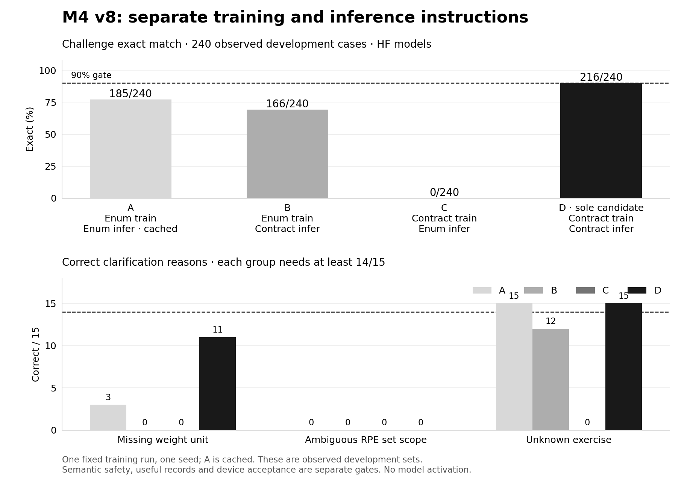

# M4 v8: training × inference contract · 2026-10-23 UTC

**Completed experiment; candidate D rejected. Native remains disabled.**

D reaches 216/240 on the observed challenge, but fails unsupported-field,
strict-clarification and reason-vocabulary gates. Quantization is deliberately
unmeasured. The 20 private originals and every derivative stay outside training
and diagnostics. Existing UI and modification confirmations are unchanged.

## Fixed experiment

Reviewed source `fd4205e8c99048a3e5e720c3ad009f30050cc34a`; protocol SHA-256
`27ca19bdff7ef481aaf3a05bdb2a020977f1b1b7f4bf1fbf667356dd75378f56`.
[Frozen protocol](../../train/GPU_V8.md) · [Preparation](../contract-v8-20261023/README.md)

| Arm | Training instructions | Inference instructions | Weight provenance |
| --- | --- | --- | --- |
| A | Short enumeration | Short enumeration | Cached v7 HF, 1,040 verified predictions |
| B | Short enumeration | Explicit schema/policy contract | Same v7 weights as A, fresh inference |
| C | Explicit contract | Short enumeration | One new original-base training, shared with D |
| D | Explicit contract | Explicit contract | Sole preselected candidate |

One 800-step / two-epoch Qwen3-0.6B training, batch 16, rank 16, learning rate
0.0002, seed 20261019, token-mean loss, 512-token limit and activation checkpointing.
All 6,400 training sentences, targets, catalogs and order remain unchanged.
All four input streams and complete training tokens/masks match reviewed hashes.
There are 3,120 new HF predictions, no retries, extra seeds, candidate switches,
changed gates, new examples or private-utterance derivatives.



## Raw outcomes

| Arm | Set | Exact | Schema valid | Unsupported fields |
| --- | --- | ---: | ---: | ---: |
| A | dev / challenge / handwritten | 642/740 · 185/240 · 49/60 | 93.51% · 96.25% · 95.00% | 249 · 162 · 16 |
| B | dev / challenge / handwritten | 444/740 · 166/240 · 32/60 | 67.84% · 84.17% · 65.00% | 234 · 148 · 17 |
| C | dev / challenge / handwritten | 0/740 · 0/240 · 0/60 | 0% · 0% · 0% | 0 · 0 · 0 |
| D | dev / challenge / handwritten | 642/740 · 216/240 · 49/60 | 94.59% · 100% · 96.67% | 221 · 136 · 20 |

Unsupported fields are the frozen scorer's `invented` diagnostic, not database
writes or necessarily fabricated numerals. In particular, **C's zero is not a
safety success**: it produces no schema-valid outputs. Of its 1,040 outputs,
1,031 parse as JSON but lack `intent`, and nine are invalid JSON; 532 echo an
`exercises`/`sentence` shape. All 240 challenge outputs lack `intent`.
B produces 90 invalid JSON outputs overall (20 challenge), including unquoted
units and missing required fields. D has valid JSON throughout, but 42 outputs
outside the challenge violate the schema, including out-of-range RPE/targets,
invalid correction units and four illegal clarification reasons. See
[output shapes](output-shapes.json) and [per-split schema counts](residuals.json).

| Arm | Missing-unit reason /15 | RPE-scope reason /15 | Unknown-action reason /15 | Paired useful positives, same order /15 | All useful positives /120 | Illegal reasons /1,040 |
| --- | ---: | ---: | ---: | --- | ---: | ---: |
| A | 3 | 0 | 15 | 12 · 10 · 14 | 101 | 6 |
| B | 0 | 0 | 12 | 13 · 12 · 14 | 102 | 34 |
| C | 0 | 0 | 0 | 0 · 0 · 0 | 0 | 0 |
| D | 11 | 0 | 15 | 14 · 14 · 14 | 115 | 4 |

Each focus needs at least 14/15 correct negative reasons and 14/15 useful positive
records; overall positives need 108/120. RPE **scope** means which sets it applies
to, separately from whether its numeric value is within 1–10. Resolved-exact can
collapse legal clarification reasons; strict reason checks remain separate.

## Factor effects and remaining errors

Changing inference text alone with old weights (A→B) loses 19 challenge matches.
Changing it with new weights (C→D) gains 216. Training effects are A→C = −185 and
B→D = +50; the arithmetic interaction is +235 cases. This large interaction is
dominated by C's format failure, **not a portable 235-case performance gain**.
It supports keeping weights, tokenizer and inference contract versioned together.
The same-input and source audits pass; there is no evidence of data replacement
or transfer corruption. This does not identify the learned mechanism for every
semantic error, and a single seed does not establish a replicated causal estimate.

Joint A→D gains 35 challenge cases and loses four (net +31). Dev has 34 gains and
34 losses; handwritten has five of each, so equal totals do not mean identical
behavior. All four new challenge losses are action-binding errors. The
[paired IDs](paired-changes.json) and [factor effects](factorial-effects.json)
retain every comparison, including the bad C arm.

The 24 remaining D challenge failures partition exactly as follows:

| Category | Count | Observed behavior |
| --- | ---: | --- |
| Ambiguous RPE scope | 15 | 12 apply RPE to every set; three assume the last set only. None asks for scope. |
| Missing weight unit | 4 | All emit `null/null` weight/unit as if unweighted. Three also treat load-like numbers as repetitions; one ignores the extra number. No `kg/lb` guess on these four. |
| Different available action | 5 | All change Dumbbell curl to Barbell curl with otherwise exact sets. |

The old curl→bench problem improves on this challenge, but wrong identity remains.
`selected` is not included in the model input; matching another context field
does not prove the model read it. Across all D outputs, ten field-exact bindings
resolve to wrong identities and five literal mismatches resolve correctly.
Four illegal reasons remain outside the challenge: `next` twice, `no reps` once,
and `felt like rpe` once. The last is also a false refusal of a valid record.
[Residual audit](residuals.json) preserves original synthetic IDs and D challenge
outputs. [Decision attribution](decision-attribution.json) has overlapping issue
counts; they must not be summed as additional failed cases.

The same observed challenge bytes underlie the earlier v2 Q8 **213/240** and v7
Q8 **180/240**. The [historical audit](../contract-v8-20261023/HISTORY.md) accounts
for 53 losses and 20 gains, with v3's training change the largest drop and later
binding regressions. V8's cached control is **HF 185**, not Q8 180. D's **HF 216**
is not a new measured Q8 peak, nor proof of independent generalization. The early
213 also failed safety/schema gates; recovering that headline score was never
sufficient for release.

## Gate and product implications

Exactly three fixed checks fail: `challengeNoInvented`, `focusNegativeReasons`,
`clarificationVocabulary`. Exact 90%, challenge schema 100%, useful positives,
source-v1 coverage, zero guarded unsafe acceptances, input/training integrity and
no truncation pass. B/C/D have no truncation; cached A retains its historical one.
The driver exits 3 for semantic rejection, not execution failure. F16/Q8 are not
exported or evaluated; agreement is `null`, not a pass or a failure.

Source-v1 guards reject unsafe outputs and retain 115/120 useful challenge cases
(95.83%); dev coverage is only 50.53%, handwritten 33.33%. Source-only v2 already
handles all 120 actionable cases on this observed challenge. Thus no incremental
benefit over source-only parsing is established. Guarded safety cannot substitute
for useful model behavior. No real user record is written by this experiment.
Candidate continuous dialogue, native integration and physical-device acceptance
remain pending. Existing cloud-path acceptance is not repeated or rebranded as a
candidate result.

## Recovery, costs and verification

- Canonical backup restores 137 run files, all four complete prediction streams,
  reviewed source and two full weights (1,232,557,264 bytes). All artifact hashes
  match; the independently restored evaluator verifies all 61 frozen sources.
- All 39 frozen reports recompute identically. Only raw-score `gold`/`system`
  absolute prefixes are normalized. Earlier complete B/C readouts also reconcile
  to canonical bytes and all six corresponding metrics. No new model calls.
- The residual audit reconciles every arm/split's failure IDs before diagnosis.
  Four regression/fault tests cover RPE scope, legal versus illegal reasons,
  missing/duplicate IDs and tampered input/manifest bytes.
- Root verification: 9 JS + 256 TS tests pass, lint has zero errors/two existing
  warnings, and production build passes. The new aggregate plot was rendered
  and visually inspected after correcting its clipped threshold annotation.
- Lossless weight transport uses 464,570,106 compressed payload bytes. Independent
  full-target reconstruction precedes canonical restoration. Twelve verified old
  transport caches (3,034,866,845 bytes) were removed; primary artifacts remain.
- A slow full-source upload was stopped and its partial file retained. A verified
  123,804-byte incremental bundle reconstructs the same source tree. Initial bare
  `python` setup failed before installation; the pinned interpreter succeeded.
  Neither incident restarted training or altered the protocol.
- AutoDL OFF was observed after backup and before timer cleanup; final OFF proof
  is **2026-10-23T04:02:26.230Z**. Original work 05:56 / power 06:56 UTC limits
  were retained. Instance/files remain. Opening-to-OFF proxy is 66.44 minutes at
  ¥2.18/hour ≈ **¥2.41**, not an invoice or an exact billing interval.
- Training step including export took 746.77 s (trainer reports 738.7 s). B/C/D
  inference steps took 742.53/564.56/746.90 s. C's faster unusable output is not a
  useful speed win. Ninety-nine 30-second samples show maximum observed GPU memory
  21,036 MiB and weighted utilization 43.79% over sampled intervals, not true peak
  or phone measurements. Cached A and concurrent transfer prohibit speed claims.

Exact-head CI and production metadata are recorded in the release/operations
receipt after this commit. Model activation remains prohibited by the failed
development gate. No credentials, weights, account screenshots or private
acceptance text are published.

## Reproduce the offline diagnostic

From the restored run and matching source, using the trusted original manifest:

```sh
node --import tsx research/m4-parser/scripts/audit-v8-residuals.ts \
  --run-dir /path/to/restored/run \
  --manifest-sha d06ba27accc6482e547819fb348d34ae2355f19b5d6c4c1b790eb5960a39658f \
  --out /path/to/new-residual-report.json
```

The CLI emits full diagnostics. This public residual JSON keeps all counts and
illegal reasons, but only D challenge failed-case labels/outputs. New analysis
code is hash-bound separately from the unchanged frozen evaluator.

[Acceptance](acceptance.json) · [Summary](summary.json) · [HF summary](hf-summary.json)
· [Replay](replay-verification.json) · [Interim reconciliation](interim-reconciliation.json)
· [Source recovery](source-recovery.json) · [File hashes](run-sha256.json)
· [Power evidence](power-off.json) · [Next CPU work](NEXT.md)
